<p align="center">
  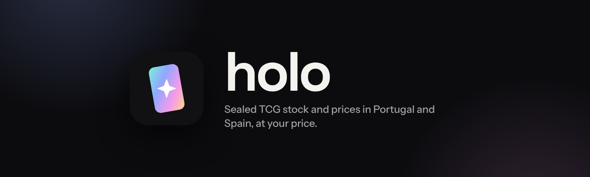
</p>

<p align="center">
  Um bot <b>self-hosted</b> que vigia lojas portuguesas e espanholas de TCG selado (Pokémon, One Piece, Riftbound, Cyberpunk, Lorcana, Magic)<br>
  e te avisa por <b>WhatsApp</b>, <b>Telegram</b> e <b>email</b> quando um produto aparece <b>em stock, no idioma certo e ao teu preço</b>.
</p>

<p align="center">
  
  
  
  
  
</p>

<p align="center">
  <a href="#funcionalidades">Funcionalidades</a> ·
  <a href="#screenshots">Screenshots</a> ·
  <a href="#arranque-rápido-docker-no-nas">Arranque rápido</a> ·
  <a href="#contas-login-e-app-no-telemóvel">Contas e login</a> ·
  <a href="#lojas">Lojas</a> ·
  <a href="#products-o-catálogo">Products</a> ·
  <a href="#releases-lançamentos">Releases</a> ·
  <a href="#desenvolvimento">Desenvolvimento</a>
</p>

<p align="center">
  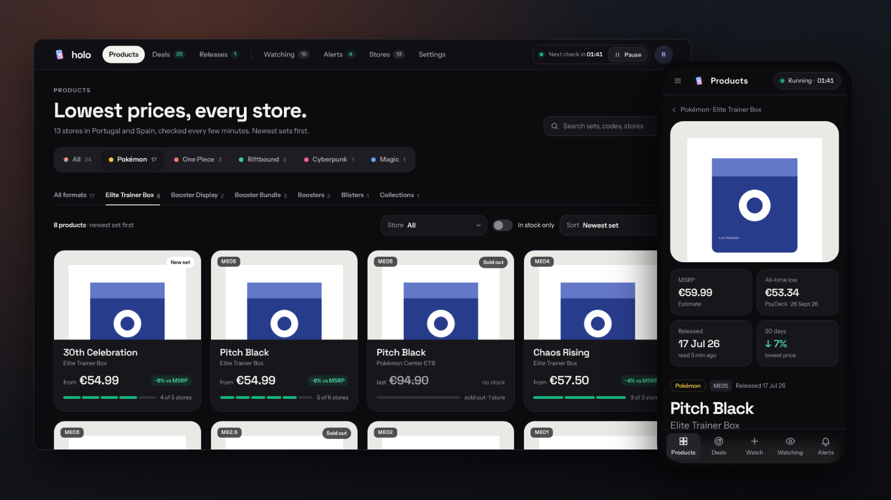
</p>

> O Holo chamava-se TcgStockBot. O código (projetos, namespaces, contentores e o volume `tcgstockbot-data`)
> mantém o nome antigo, para as atualizações não perderem nada.

---

## Funcionalidades

**Separadores por jogo**

- Todas as páginas principais (Products, Deals, Watching, Releases e Alerts) têm separadores **All · Pokémon ·
  One Piece · Riftbound · Cyberpunk**, mais Lorcana, Magic ou Outro quando os usas. A escolha fica guardada no browser.

**Vigiar produtos**

- Cada **produto vigiado** (tarefa) pode ser um produto (30th ETB) ou um **set inteiro** (Chaos Rising): o texto de pesquisa, as palavras obrigatórias e excluídas (com alternativas `a|b` e prefixos `op*`), os **tipos de produto** que queres (ETB, Booster Bundle, Display…; nenhum = todos), o **idioma** (inglês ou japonês), as lojas e o **jogo** (Pokémon, One Piece, Riftbound, Cyberpunk, Lorcana, Magic ou outro).
- **Regra de preço:** **MSRP + margem** (cada tipo comparado com o seu MSRP: um booster com o MSRP de um booster, uma display com o de uma display) ou um **preço máximo fixo**.
- **Jogo certo:** um produto genérico (booster box, booster, deck…) só conta se o título disser o jogo ("Pokémon",
  "PKM", "One Piece"…) ou uma coleção conhecida dele; assim uma display de Flesh & Blood ou Naruto não aparece como
  Pokémon. Os formatos que só a Pokémon tem (ETB, Booster Bundle, UPC…) não precisam.
- Os **starter decks** de One Piece são reconhecidos pelo código (ST-01, ST01, ST 1), seja qual for o resto do título.
- Em cada ciclo, o bot pesquisa em todas as lojas e explica cada resultado: *ao teu preço*, *acima · avisa até 65,99 €*, *esgotado*, *não é inglês*, *tipo que não vigias*, *falta a palavra…*.
- Os resultados e os alertas trazem a **imagem do produto** que a loja devolve.
- Importar e exportar os produtos vigiados (tarefas) em JSON, no menu **More** de *Watching*.

**Produtos (catálogo) e preços**

- **Products** (a página inicial): escolhes o **jogo**, depois o **formato** (Elite Trainer Box, Booster Display,
  Booster Bundle, Boosters, Blisters, Collections, Tins, Decks) e aparecem os produtos de **todas as coleções**, da mais
  recente para a mais antiga. Cada cartão tem a coleção, a foto, "desde X €", "−8% vs MSRP", a variação em 30 dias e
  "em stock em 3 de 5 lojas". Filtros por loja e "só em stock"; ordenação por coleção mais recente, mais barato, mais
  lojas com stock, maior descida ou nome.
- **Um produto = jogo + coleção + formato**, seja qual for o produto vigiado que o encontrou. O bot reconhece a coleção
  pelo título da loja: o nome ("Pitch Black"), o código ("ME05", "OP-13", "op13") ou outros nomes. Assim, "Pitch Black
  ETB", "PKM ME05 Pitch Black Elite Trainer Box" e "Mega Evolution 5 - Pitch Black ETB" são o mesmo produto, mesmo
  com um único produto vigiado para todas as ETBs.
- **Página do produto:** em cima, o mais barato com stock e o botão para abrir a loja; logo a seguir, **os preços em
  todas as lojas, do mais barato para o mais caro** (com PT/ES, "−8% vs MSRP" e quando foi verificado), com as
  esgotadas recolhidas. Depois, os factos do preço (mínimo de sempre, variação em 30 dias, MSRP), os **outros formatos
  da mesma coleção**, o **gráfico de preços** por período, o histórico de alterações e as correções (separar ou juntar
  anúncios).
- **MSRP** por tipo de produto (ETB, Booster Bundle, Display…), para veres quanto acima ou abaixo do preço de referência está cada oferta.

**Releases (lançamentos)**

- Calendário das próximas expansões, em **lista** (pré-vendas abertas, próximos, já saíram) ou **mês a mês**, com a
  data de lançamento e a abertura das pré-vendas. Cada lançamento pode ficar ligado ao produto que vigias, para veres
  ali as ofertas; se ainda não o vigias, **Vigiar** abre a pesquisa já preenchida.
- **Coleções:** o bot já conhece as coleções inglesas de Pokémon (Scarlet & Violet e Mega Evolution), One Piece
  (OP-01 a OP-18, EB e PRB), Riftbound e Cyberpunk (`Features/Sets/Data/set-defaults.json`), e todas as que têm data
  **aparecem sozinhas em Releases** (com a etiqueta *Built-in*). Editar uma delas guarda a data das pré-vendas, notas e
  link. Uma coleção nova entra quando a adicionas em Releases: o nome (sem o jogo à frente) e os **outros nomes nas
  lojas** (por exemplo `ME06`) passam a agrupar os produtos dessa coleção em Products.
- Cada lançamento mostra o que as lojas têm dessa coleção ("4 produtos · 3 em stock · desde 54,99 €") e abre Products
  só com essa coleção.

**Avisos**

- **WhatsApp** (CallMeBot), **Telegram** (um bot teu) e **email** (SMTP), com o link direto para a página do produto.
- **Resumo diário** opcional, à hora que escolheres: os alertas das últimas 24 horas, o que está em stock ao teu preço e as lojas com erro.
- Um produto só é avisado uma vez enquanto continuar em stock, a não ser que **baixe de preço**.
- **Pré-vendas** marcadas no aviso e no dashboard.
- Lojas que não dizem o idioma no título podem **avisar na mesma, com "confirma o idioma"**.

**Dashboard**

- **Deals** (antigo Radar): as ofertas que podes comprar agora. As **novidades** das últimas 24 horas em cartões grandes (foto, loja, preço e "−8% vs MSRP"); as que continuam disponíveis numa lista que filtras por tipo e ordenas por data, preço ou MSRP. Ao lado, os **últimos movimentos** (reposições, descidas e pré-vendas, com o jogo), a saúde das lojas e a atividade.
- **Watching:** um cartão por produto/set com a regra de preço e, **por tipo** (ETB, Bundle, Display, Booster), o melhor preço agora. Cada um tem a sua página: os limites por tipo, o que as lojas têm (por tipo ou por loja) e porque é que avisou ou não, o histórico de preço e os alertas.
- **Watch a product:** pesquisas em todas as lojas ao mesmo tempo, marcas os resultados certos e as regras (nome, tipos, MSRP + margem, palavras, lojas) são sugeridas a partir deles.
- **Stores:** lojas portuguesas e espanholas agrupadas por **área** (Portugal, Espanha, Europa) e **tier**, com o estado de cada pesquisa do último ciclo, etiquetas e notas. **Detect** a plataforma a partir do link, **testar** várias lojas de uma vez, e desligar automaticamente as que falham. **Test a store** abre-se a partir daqui.
- **Menu em dois grupos:** **Shop** (Products, Deals, Releases), para comprar, e **Bot** (Watching, Alerts, Stores, Settings), para configurar.
- **Design Holo:** barra de navegação no topo (no telemóvel, a barra em baixo), títulos e preços em Space Grotesk e
  texto em Instrument Sans (servidos pela própria app), verde para "em stock" e "abaixo do MSRP", e uma "embalagem" com
  as cores da coleção quando a loja não tem foto.
- **Temas:** Holo, Coral, Lavanda e Oceano, em modo escuro (por omissão), claro ou automático.
- **Contas:** cada pessoa entra com o seu utilizador (Sign in / Create account), com "Keep me signed in"; o admin gere as contas. Uma **página de apresentação** para quem chega sem sessão.
- **Em inglês**, com os preços em euros (€54.99) e as datas no formato europeu.
- **App no telemóvel:** barra de navegação em baixo, e instala-se no ecrã principal com o ícone do Holo.
- Atalhos: `1`–`7` mudam de página, `N` vigia um produto novo, `/` vai para a pesquisa e `R` verifica logo.

**Feito para correr em casa**

- Dois contentores num só `docker-compose.yml`, pensado para um NAS UGREEN: o **bot** e o **dashboard** com login.
- Cada loja usa só o mecanismo que ela própria autoriza: pesquisa pública da loja, API oficial ou feed de afiliados. Não contorna CAPTCHAs nem proteções anti-bot.
- Limites de pedidos por domínio, respeita o `Retry-After` das lojas e nunca escreve segredos nos logs.

> Só monitoriza e avisa: a compra fazes tu.

## Screenshots

Com dados de exemplo. Quando a loja devolve a foto do produto, aparece no lugar do desenho.

### Products
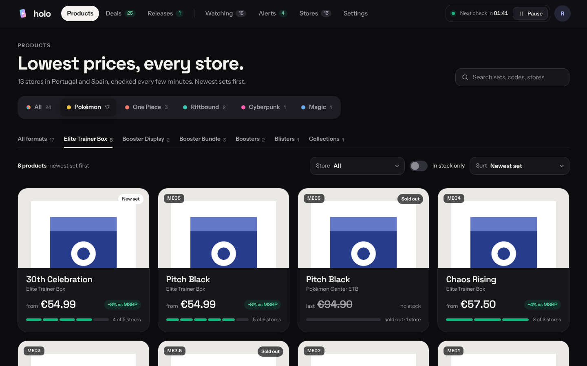

<table>
<tr>
<td width="50%"><b>Product page</b><br>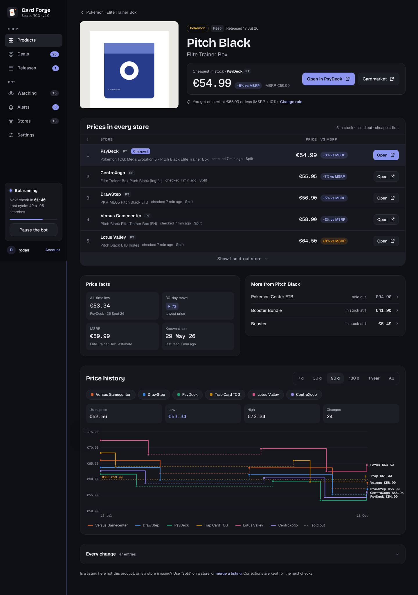</td>
<td width="50%"><b>Deals</b><br>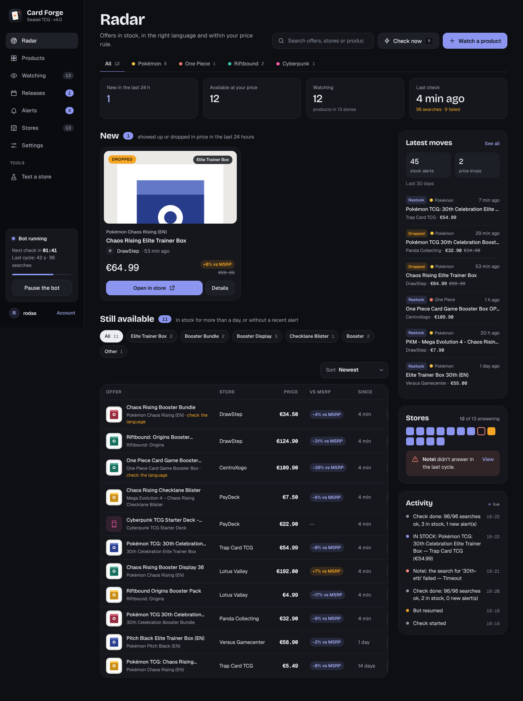</td>
</tr>
<tr>
<td width="50%"><b>Releases</b><br>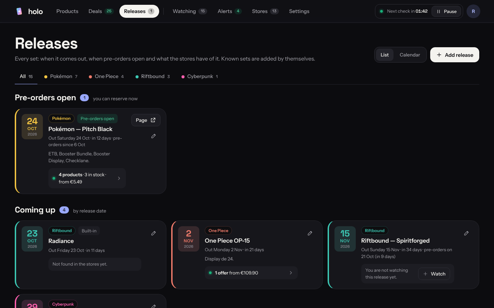</td>
<td width="50%"><b>Watching</b><br>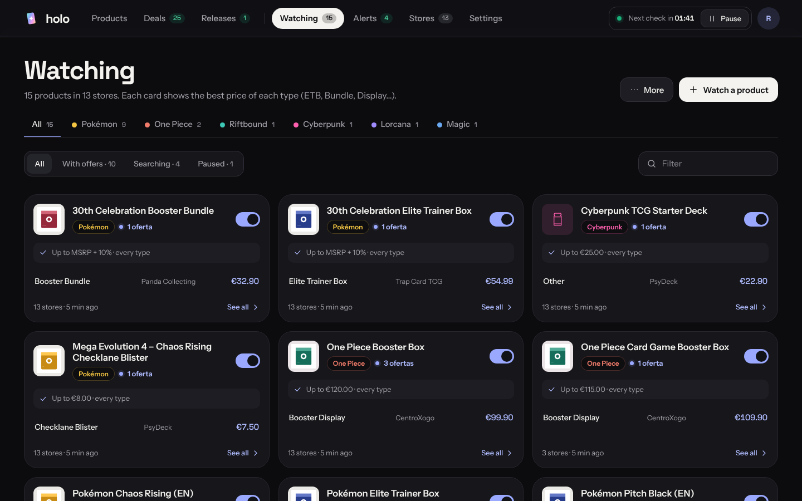</td>
</tr>
<tr>
<td width="50%"><b>Watched product</b><br>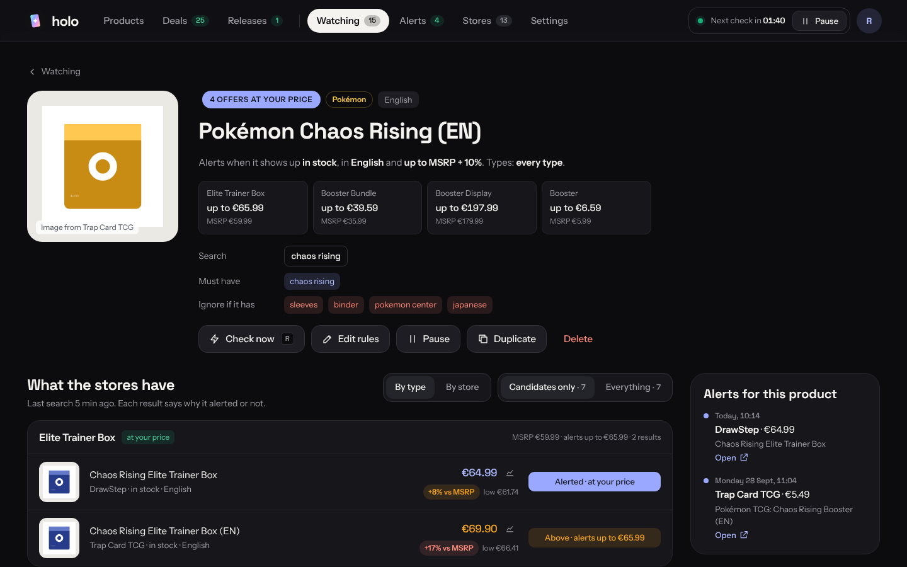</td>
<td width="50%"><b>Watch a product</b><br>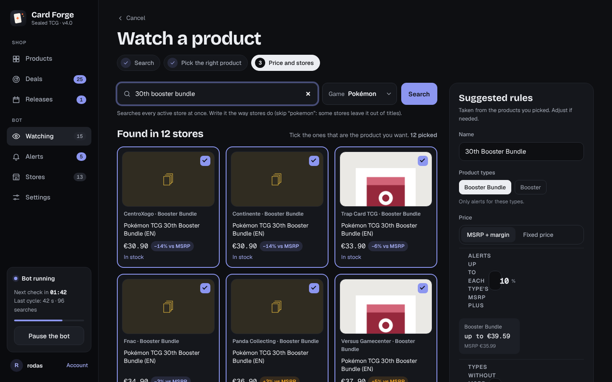</td>
</tr>
<tr>
<td width="50%"><b>Alerts</b><br>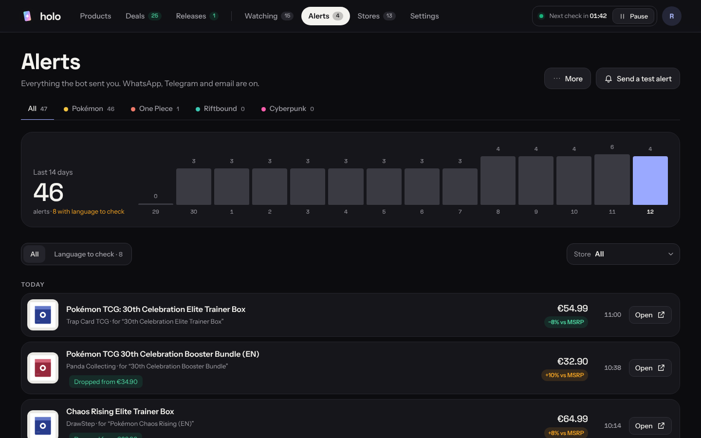</td>
<td width="50%"><b>Stores</b><br>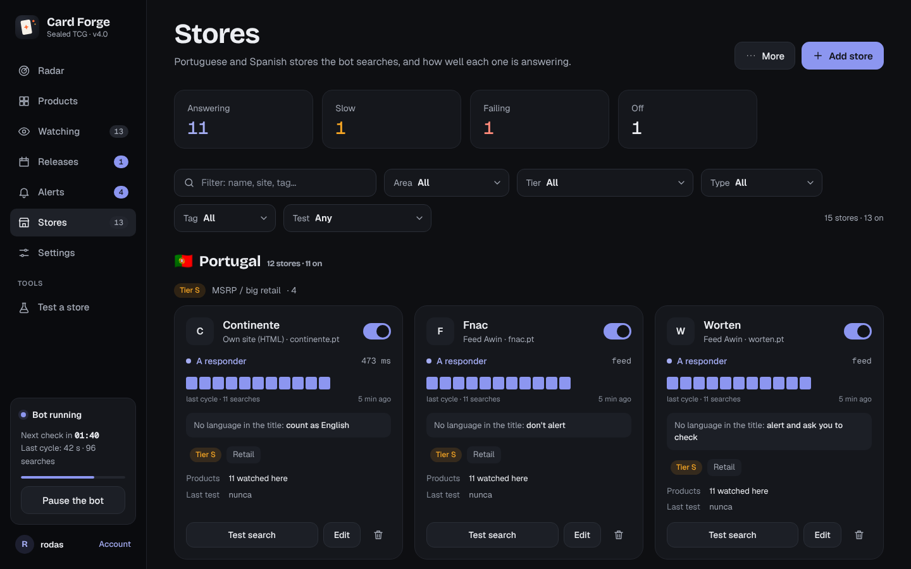</td>
</tr>
<tr>
<td width="50%"><b>Settings</b><br>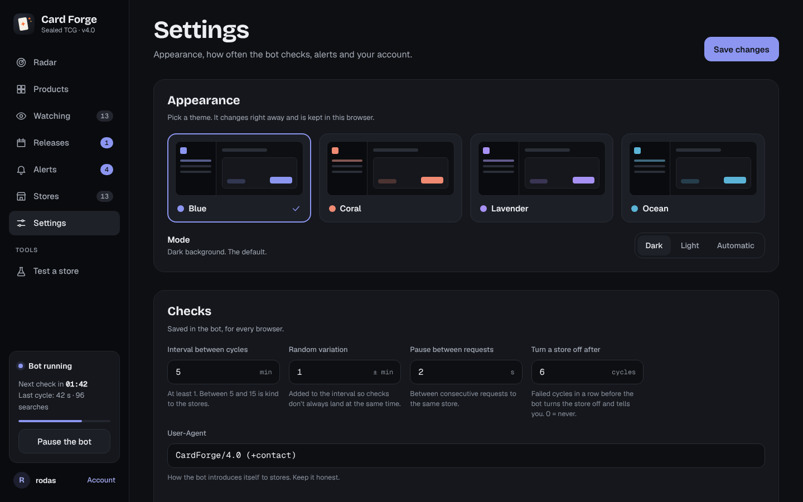</td>
<td width="50%"><b>About</b><br>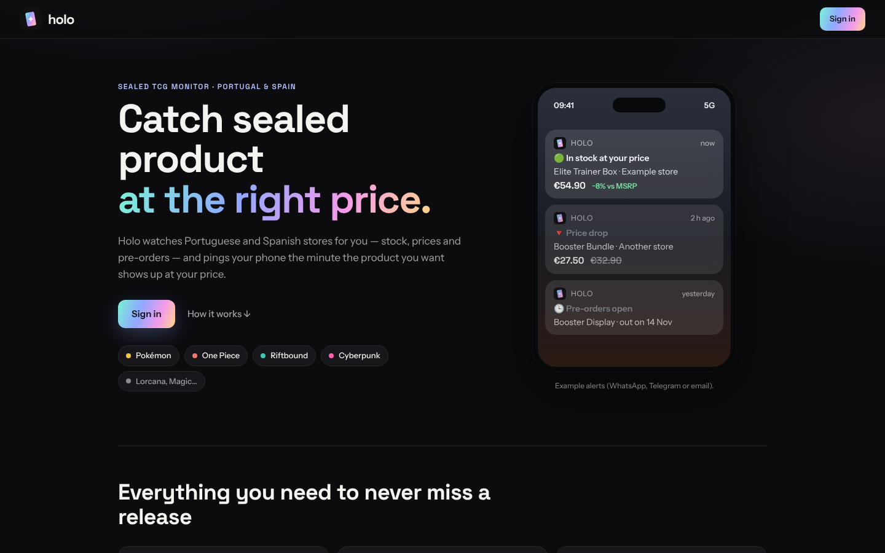</td>
</tr>
<tr>
<td width="50%"><b>Sign in</b><br>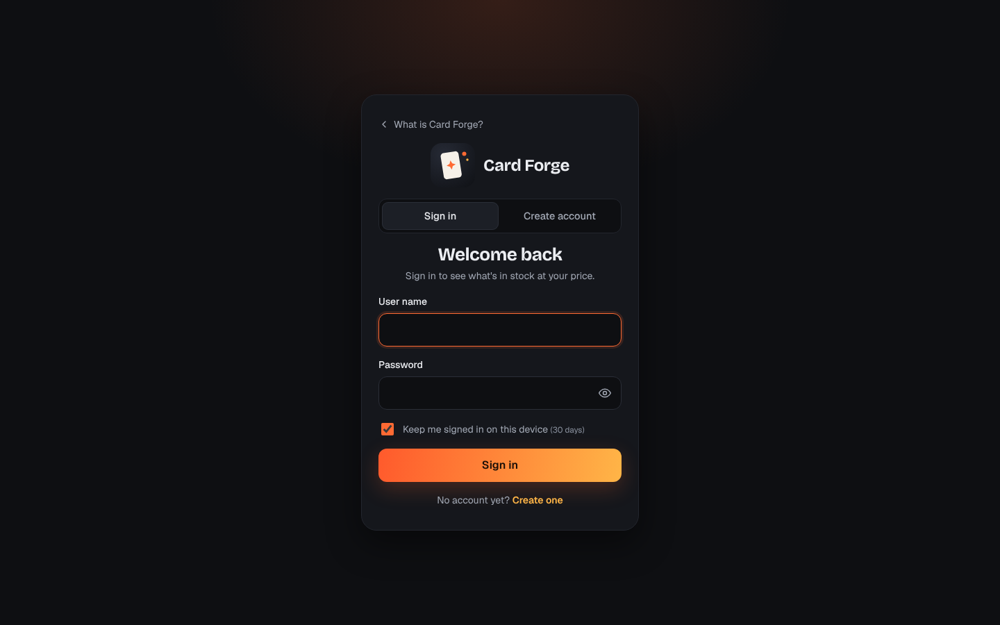</td>
<td width="50%"><b>No telemóvel</b><br>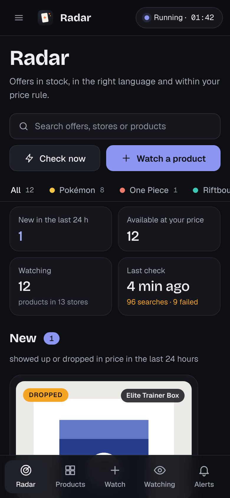</td>
</tr>
</table>

<table>
<tr>
<td width="33%"><b>About (telemóvel)</b><br>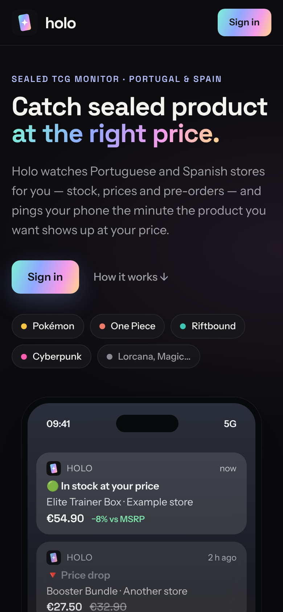</td>
<td width="33%"><b>Sign in (telemóvel)</b><br>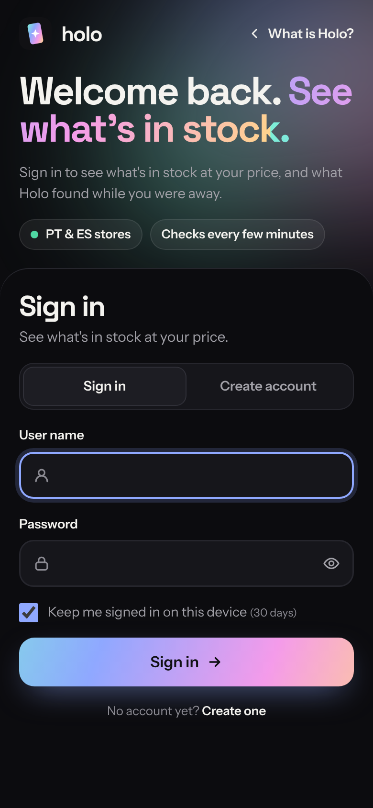</td>
<td width="33%"><b>Primeira conta</b><br>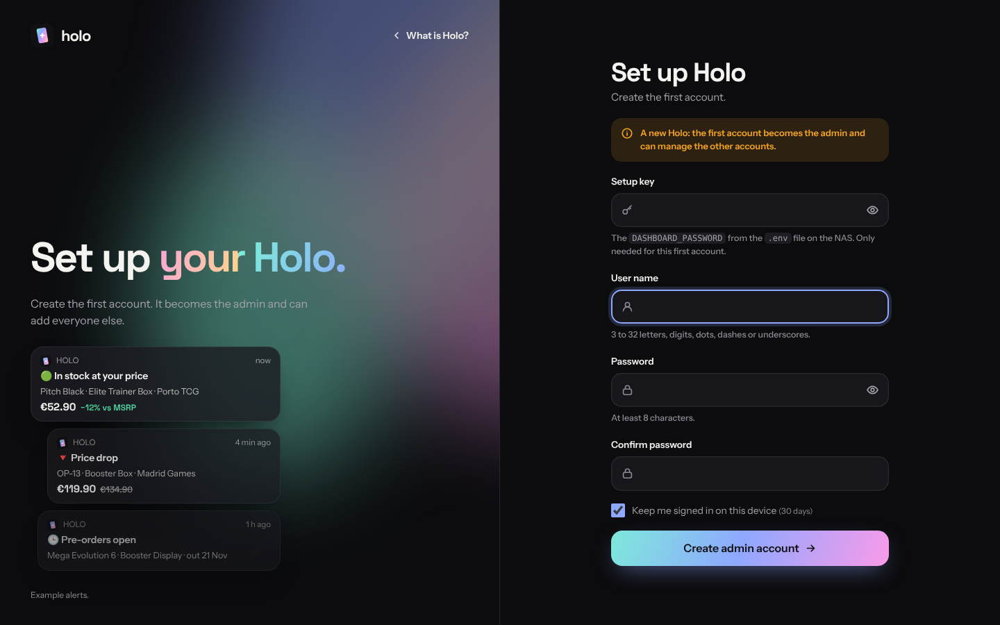</td>
</tr>
</table>

### Temas

Quatro cores (Holo, Coral, Lavanda e Oceano), cada uma em modo escuro (por omissão), claro ou automático, a seguir o sistema.

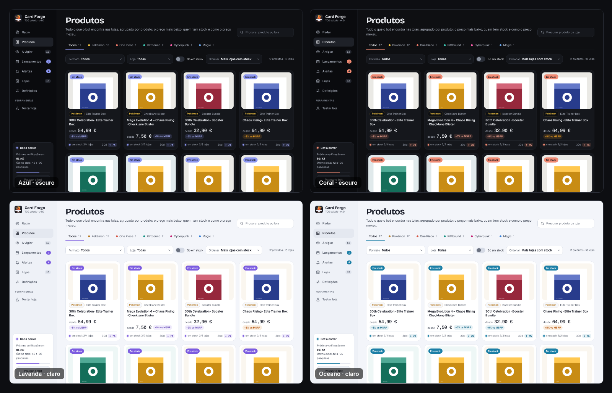

## Arranque rápido (Docker no NAS)

```bash
cp .env.example .env          # preenche DASHBOARD_PASSWORD (setup key), TCG_API_KEY e o WhatsApp, o Telegram e/ou o email
docker compose up -d --build --remove-orphans
# abre http://<IP-do-NAS>:5080
```

São dois contentores:

| Contentor | Porta | O que faz |
| --- | --- | --- |
| `tcgstockbot-webapi` | nenhuma | o bot: monitor em segundo plano e API JSON (`x-api-key`) |
| `tcgstockbot-website` | `5080` | o Holo (dashboard), com login |

1. Copia a pasta da solução para o NAS (por exemplo `docker/tcgstockbot`).
2. Copia `.env.example` para `.env` e preenche `DASHBOARD_PASSWORD`, `TCG_API_KEY` (uma chave longa e aleatória) e o WhatsApp, o Telegram e/ou o email.
3. Arranca pela app Docker do UGOS (um *Projeto* a apontar para a pasta) ou por SSH, com o comando acima.
4. Abre `http://<IP-do-NAS>:5080`.

**Ao atualizar:** `git pull` na pasta e o mesmo `docker compose up -d --build --remove-orphans`. O `.env` não está no git, por isso nunca é tocado. Se vens de uma versão com o proxy (`price-proxy`), o `--remove-orphans` apaga esse contentor, e as linhas `OutboundHttp__Proxy__…` que ficarem no `.env` são ignoradas.

A configuração, as tarefas, o histórico e os lançamentos ficam no volume `tcgstockbot-data`; as chaves das sessões
(para o "manter sessão" sobreviver às atualizações) ficam no volume `tcgstockbot-keys`. Nunca corras
`docker compose down -v`, que os apaga.

> [!WARNING]
> Não abras a porta 5080 no router, porque a password passa sem HTTPS. Para aceder de fora de casa, usa uma VPN (por exemplo Tailscale).

## Contas, login e app no telemóvel

A app está em **inglês**. Os endereços são `#/products` (a página inicial), `#/radar` (Deals), `#/watching`, `#/releases`, `#/alerts`,
`#/stores` e `#/settings`; os links antigos em português continuam a funcionar.

- **Contas:** cada pessoa entra com o seu utilizador e password. As contas ficam no bot (`data/users.json`), com a
  password guardada só como hash (PBKDF2). Toda a gente vê e mexe nos mesmos produtos, lojas e alertas.
- **Primeira visita:** sem contas, `http://<IP-do-NAS>:5080` abre **Set up Holo** para criares a primeira conta,
  que fica **admin**. É pedida a **setup key**: é a `DASHBOARD_PASSWORD` do `.env`, para ninguém na rede a criar antes de ti.
- **Sign in / Create account:** quem ainda não tem conta cria-a no separador **Create account** (como na Living Dex).
  Com `ALLOW_REGISTRATION=false` no `.env`, só o admin cria contas, em **Settings → Account**.
- **Keep me signed in on this device** mantém a sessão 30 dias (`Dashboard__RememberDays`). Mudar a password termina
  as sessões dos outros dispositivos. Cinco passwords erradas seguidas, do mesmo endereço, bloqueiam as tentativas 5 minutos.
- **Settings → Account:** mudar a password, **Sign out** e, para o admin, a lista de contas (adicionar e apagar).
- Sem sessão, `/` mostra a **página de apresentação** (o que o Holo faz), também em `/about`.
- **Instalar no telemóvel:** no iPhone, no Safari, Partilhar → *Adicionar ao ecrã principal*; no Android, no Chrome,
  ⋮ → *Adicionar ao ecrã principal*. Fica com o ícone e o nome Holo e abre em ecrã inteiro. Com HTTPS (por
  exemplo o proxy reverso do NAS ou o Tailscale), o Chrome também oferece *Instalar app*.

<details>
<summary><b>Vindo da v2 (um só contentor <code>tcgstockbot</code>)?</b></summary>

Usa o mesmo nome de pasta. O volume `tcgstockbot-data` é o mesmo e o formato dos ficheiros não mudou, por isso as tarefas, as lojas e o histórico mantêm-se.

- O `--remove-orphans` apaga o contentor antigo.
- No `.env`, a antiga `Dashboard__Password` passa a chamar-se `DASHBOARD_PASSWORD`.
- Acrescenta também `TCG_API_KEY`.
</details>

> [!IMPORTANT]
> **Nunca faças commit de segredos.** O `.env` e os `appsettings.Development.json` estão no `.gitignore`. Para correr no PC, copia `TcgStockBot.WebApi/appsettings.Development.json.example` para `appsettings.Development.json` (e o mesmo no Website, se precisares).

### WhatsApp (CallMeBot)

1. Guarda nos contactos o número publicado em https://www.callmebot.com/blog/free-api-whatsapp-messages/
2. Envia-lhe por WhatsApp: `I allow callmebot to send me messages`. Recebes a API key numa resposta.
3. No `.env`: `WhatsApp__Enabled=true`, `WhatsApp__Phone=+351…` (o teu número) e `WhatsApp__ApiKey=…`.
4. `docker compose up -d`, e depois, em **Settings → Alert channels → WhatsApp**, carrega em *Send a test message*.

O CallMeBot é um serviço gratuito de terceiros, só para uso pessoal, e sem garantias. Mantém o email ou o Telegram ligado como segundo canal.

### Telegram

1. No Telegram, fala com **@BotFather** → `/newbot` e escolhe um nome. Recebes o **token** do bot.
2. Abre o bot novo e envia-lhe `/start` (sem isto, o Telegram não deixa o bot escrever-te).
3. Descobre o teu **chat id** (por exemplo com **@userinfobot**). Num grupo, o id começa por `-100`.
4. No `.env`: `Telegram__Enabled=true`, `Telegram__BotToken=…` e `Telegram__ChatId=…`.
5. `docker compose up -d`, e depois, em **Settings → Alert channels → Telegram**, carrega em *Send a test message*.

O token só existe no `.env`: o dashboard mostra apenas se está definido, e os logs nunca o escrevem.

### Resumo diário

Em **Settings → Daily summary**, liga o resumo e escolhe a hora (de Portugal). Uma vez por dia, vai pelos canais
ligados (email, Telegram e WhatsApp) com os alertas das últimas 24 horas, o que está em stock ao teu preço e as lojas
que falharam no último ciclo.

## Lojas

| Plataforma | Como pesquisa | Imagem do produto |
| --- | --- | --- |
| `Shopify` | pesquisa pública da loja (`/search/suggest.json`) ou o catálogo (`/products.json`) | `featured_image` ou `image`; no catálogo, a primeira de `images` |
| `WooCommerce` | Store API pública (`/wp-json/wc/store/…`) | a primeira de `images` |
| `Html` | lê a página de pesquisa com seletores CSS | a primeira `` do cartão (também `data-src` de imagens com *lazy loading*) |
| `Amazon` | API oficial **Creators API** | `images.primary.large` |
| `ElCorteIngles`, `Worten`, `Fnac`, `Awin` (genérico) | feed de produtos de afiliados **Awin** | `merchant_image_url`, `large_image`, `aw_image_url` ou `aw_thumb_url` |
| `Manual` (sem integração) | nunca é pesquisada: fica só na lista, com link, tier e etiquetas | — |

### Idioma sem marcador (por loja)

| Opção | Comportamento |
| --- | --- |
| Não avisar | título sem "(EN)/Inglês/(PT)…" → não avisa |
| Contar como inglês | a loja marca sempre os PT/ES/JP, por isso sem marcador = inglês |
| **Avisar com idioma por confirmar** | avisa na mesma, e o WhatsApp, o email e o dashboard pedem para confirmares na página (usado na CentroXogo) |

### Lojas Shopify: pesquisa ou catálogo

Por omissão, o bot usa a pesquisa da loja (`/search/suggest.json`), que devolve **no máximo 10 produtos** por
pesquisa. Numa loja com muitos produtos do mesmo set, alguns ficam de fora.

Em **Lojas → editar → Catálogo**, podes indicar uma ou mais coleções, separadas por vírgula:

| Loja | Catálogo |
| --- | --- |
| Versus Gamecenter | `/collections/pokemon-tcg-1, /collections/riftbound-league-of-legends-tcg` |
| Note! | `/collections/pokemon` |
| Trap Card TCG | `/collections/pokemon-booster-boxes, /collections/pokemon-elite-trainer-boxes, /collections/pokemon-collection-boxes, /collections/pokemon-tins, /collections/pokemon-booster-packs` |

- Com catálogo, o bot lê as coleções (páginas de 250 produtos) **uma vez por ciclo** e filtra-as localmente
  para todas as tarefas dessa loja. Não há limite de 10, e são menos pedidos do que uma pesquisa por tarefa.
- O texto de pesquisa da tarefa tem de aparecer no título, no tipo, no fabricante ou nas tags do produto
  (palavras inteiras, sem acentos).
- `/products.json` lê a loja inteira. Funciona, mas numa loja grande são muitas páginas por ciclo, por isso
  prefere as coleções.
- Para descobrires as coleções de uma loja, abre `https://<loja>/collections.json` no browser.
- Uma coleção vazia ou errada não dá erro, só não devolve produtos. Confirma em **Test a store**.

### Lojas: áreas, tiers e etiquetas

O separador **Lojas** agrupa as lojas por **área** (Portugal, Espanha, Europa/online) e, dentro de cada área, por
**tier**:

| Tier | Para quê |
| --- | --- |
| **S** | MSRP / grande retalho (Amazon, Worten, FNAC, Continente, El Corte Inglés, Toys R Us…) |
| **A** | Especialistas TCG |
| **B** | Importadores e lojas online mais pequenas |
| **C** | Marketplaces (Cardmarket, eBay, Wallapop, Vinted): só referência, não comparável com o MSRP |

Cada loja tem também um **tipo** (Retalho, Especialista TCG, Importador, Marketplace, Oficial), **etiquetas** livres
(ex.: `por testar`, `confirmar envio para PT`) e **notas**. Tudo isto é só classificação: não muda a forma como a loja é
pesquisada. Filtra por área, tier, tipo ou etiqueta no topo da página (clicar numa etiqueta de um cartão também filtra).

Plataformas novas:
- **Sem integração** (`Manual`): a loja fica na lista (link, tier, etiquetas) mas o bot **nunca a pesquisa**. Serve
  para lojas que ainda não sabes como ler, ou que não autorizam leitura automática.
- **Awin (genérico)** (`Awin`): qualquer outra loja com programa de afiliados Awin e feed de produtos (MediaMarkt,
  FNAC ES…). Dás-lhe uma **chave** (ex.: `MediaMarktES`) e pões o URL do feed em `AwinFeeds__Feeds__MediaMarktES` no
  `.env`. Funciona como os feeds da secção seguinte.

**Importar / Exportar JSON** (menu **More** da página Stores; mesmo formato nos dois sentidos). Numa loja que já existe (mesmo nome **ou** mesmo site),
a importação não mexe na configuração: com *Atualizar classificação* ligado, muda só área, tier, tipo e etiquetas.

#### Detetar, testar e ativar lojas

- **Detect** (no formulário da loja, ao lado do URL): cola o site ou a página da categoria Pokémon. O bot faz uns
  poucos pedidos normais (com o mesmo User-Agent e os mesmos limites por domínio) e preenche a configuração:
  - **Shopify**: `/products.json` responde. Propõe a coleção para o modo catálogo (a do URL que colaste, ou
    `pokemon`, `pokemon-tcg`, `pokemon-tcg-1`, `all-pokemon`);
  - **WooCommerce**: a Store API `/wp-json/wc/store/v1/products` (ou sem `/v1`) responde;
  - **PrestaShop**: a pesquisa `index.php?controller=search` tem cartões `product-miniature`. Preenche os seletores
    HTML genéricos (confirma o esgotado no Testar);
  - **bloqueia o bot** (403/429 ou página anti-bot): para aí e não contorna nada. Fica "Sem integração".
- **Test several stores** (menu **More** da página Stores): pesquisa cada loja (4 de cada vez) com um texto à escolha
  ("pokemon" por omissão), mostra o resultado de cada uma e guarda-o no cartão ("Último teste"). Escolhe quais: as
  visíveis com os filtros, as nunca testadas, as que falharam, as desligadas ou todas. No fim:
  - **Ativar as que funcionam**;
  - **Desligar as que falharam**;
  - **Bloqueadas → Sem integração** (com a etiqueta `bloqueia bots (403)`);
  - **Voltar a detetar a plataforma** das que deram erro, 0 produtos ou não têm integração. Se a deteção encontrar
    uma plataforma, a loja é atualizada e testada de novo.

  Um teste com produtos tira a etiqueta `por testar`. Há um filtro "Último teste" (nunca testadas, OK, falhou,
  desligadas pelo bot).
- **Desligar automático** (Settings → "Turn a store off after N cycles", 6 por omissão, 0 = nunca): quando
  todas as pesquisas de uma loja ativa falham N ciclos seguidos, o bot desliga-a, põe-lhe a etiqueta `a falhar` e
  avisa-te uma vez (WhatsApp/email). Não contam os pedidos adiados pelo limite por domínio do próprio bot, nem as
  lojas por configurar (Amazon sem credenciais, feed Awin em falta). Um ciclo com uma pesquisa bem-sucedida põe o
  contador a zero; ligar a loja de novo também, e tira a etiqueta.

### Lojas grandes: Amazon, FNAC, Worten e El Corte Inglés

Cada loja usa só o mecanismo que ela própria autoriza. O bot não contorna CAPTCHAs, Cloudflare/Akamai, deteção de bots, bloqueios de IP nem limites de pedidos, e não faz scraping da Amazon.

| Loja | Plataforma no dashboard | Mecanismo | Estado |
| --- | --- | --- | --- |
| Amazon.es | `Amazon` | API oficial **Creators API** (sucessora da PA-API 5) | funciona com credenciais de Associates |
| El Corte Inglés (ES) | `ElCorteIngles` | feed de produtos do programa de afiliados **Awin 13075** | funciona depois de o programa te aprovar e configurares o feed |
| Worten | `Worten` | feed de produtos do programa **Awin 99897** ("Worten PT") | o programa existe; **não foi possível confirmar que tem feed** |
| FNAC Portugal | `Fnac` | nenhum mecanismo autorizado confirmado | **não suportada**: só funciona se obtiveres um feed Awin autorizado da FNAC PT |

Nenhuma das três tem API pública de produtos. As APIs de marketplace (Mirakl, e a API XML da FNAC) são só para vendedores com conta aprovada, por isso não servem para acompanhar preços. Os sites respondem 403 ao bot, e os termos de uso restringem a reprodução do conteúdo. Por isso **não há scraper** para estas lojas: os providers leem só o feed Awin e nunca contactam o site da loja.

<details>
<summary><b>Amazon.es (Creators API)</b></summary>

1. Precisas de uma conta **Amazon Associates** (programa de afiliados) aprovada. A Amazon só dá acesso à Creators API a contas com **10 vendas qualificadas nos últimos 30 dias**.
2. Em Associates Central → *Tools → Creators API*: cria uma aplicação e uma credencial. Anota o **Credential ID**, o **Credential Secret** (só aparece uma vez) e a **versão** (amazon.es = `3.2`).
3. No `.env`: `Amazon__CredentialId`, `Amazon__CredentialSecret`, `Amazon__CredentialVersion=3.2` e `Amazon__PartnerTag` (a tua tag, ex.: `atua-tag-21`). Nunca no código nem no `appsettings.json`.
4. `docker compose up -d`. No dashboard, adiciona uma loja com a plataforma **Amazon** e URL base `https://www.amazon.es`, e carrega em *Testar*.

Numa tarefa, o texto de pesquisa pode ser palavras-chave (usa `SearchItems`) ou um ASIN, por exemplo `B0XXXXXXXX` ou `asin:B0XXXXXXXX` (usa `GetItems`, que é mais exato). O preço vem da oferta *buy box*, e o vendedor (ex.: *Amazon.es* ou um revendedor) aparece no resultado. Contam como disponível: `IN_STOCK`, `IN_STOCK_SCARCE`, `PREORDER`, `LEADTIME` e `AVAILABLE_DATE`.

O token OAuth dura 1 hora e fica em cache. A API permite ~1 pedido/segundo e 8640/dia, por isso o limite por omissão para `amazon.es` é de 2 segundos entre pedidos.

Sem credenciais, a loja mostra *"Amazon: integração não configurada"* e a Amazon não é contactada.
</details>

<details>
<summary><b>FNAC, Worten e El Corte Inglés (feeds Awin)</b></summary>

1. Cria uma conta de *publisher* na [Awin](https://www.awin.com) e candidata-te ao programa: El Corte Ingles ES (13075) ou Worten PT (99897). Só depois da aprovação tens acesso ao feed. A FNAC PT não tem programa confirmado: se encontrares um, o processo é o mesmo.
2. Em *Toolbox → Create-a-Feed*, escolhe o feed do anunciante, **CSV**, delimitador **vírgula** (pipe e tab também são aceites), compressão **gzip** ou nenhuma, e as colunas `product_name`, `search_price`, `currency`, `in_stock`, `stock_status`, `merchant_deep_link`, `aw_deep_link`, `merchant_product_id`, `merchant_name` e `merchant_image_url` (ou `aw_image_url`, para a imagem).
3. Copia o URL de download para o `.env`: `AwinFeeds__Feeds__ElCorteIngles=…` (ou `…__Worten`, `…__Fnac`). Esse URL tem a tua chave de feed, por isso é **secreto**. Nos logs aparece só como `datafeed.api.productserve.com/… (Awin feed ElCorteIngles)`.
4. No dashboard, adiciona a loja com a plataforma correspondente e o URL base (ex.: `https://www.elcorteingles.es`).

Como funciona:
- O feed é descarregado **no máximo uma vez a cada `AwinFeeds:RefreshInterval`** (6 h por omissão, mínimo 1 h) e é partilhado por todas as tarefas. As pesquisas filtram-no localmente (todas as palavras do texto de pesquisa no título, sem acentos).
- Um download falhado só volta a ser tentado passados `RetryAfterFailure` (30 min). Entretanto, usa-se o último feed bom, se houver.
- Só ficam em memória os produtos com `KeepKeywords` no título (por omissão `pokemon`, `one piece`, `lorcana` e `gathering`), até `MaxProducts` (5000). Os feeds dos grandes retalhistas têm centenas de milhares de produtos.
- O stock segue as regras da Awin: `in_stock` 1/0 (vazio = sem informação); senão `stock_quantity`, e senão `stock_status` (in stock / out of stock / preorder…). O link é o da loja (`merchant_deep_link`); se faltar, usa-se o `aw_deep_link`.
- Os preços do feed estão atrasados até à última importação da Awin. Confirma sempre na loja antes de comprar.
</details>

## Alertas, descidas de preço e histórico

- **Em stock:** um produto que passa a tarefa (palavras, idioma, stock e preço máximo) avisa uma vez. Não volta a
  avisar enquanto continuar em stock, a não ser que o preço desça.
- **Baixou de preço:** um produto já avisado volta a avisar quando o preço desce pelo menos 1 % e 0,50 € abaixo do
  último preço avisado (ex.: 130 € → 115 €). Se o preço subir e depois voltar ao mesmo valor, não avisa outra vez.
  A mensagem mostra o preço antigo: "🔻 115,00 € (antes 130,00 €)".
- **Pré-venda:** marcada quando o título o diz ("Pré-venda", "Pre-order", "Reserva", "Preventa"…) ou quando a Amazon
  (`PREORDER`) ou o feed Awin (`stock_status`) o indicam. Aparece no aviso e no dashboard.
- **Histórico de preços** (`data/price-history.json`): para cada produto que uma tarefa
  reconhece (palavras e idioma certos, esteja ou não em stock ou acima do preço), guarda um ponto sempre que o preço
  ou o stock mudam. São até 500 alterações por produto, e os produtos que não aparecem há 180 dias são apagados. O
  mesmo produto em várias tarefas conta como um só (loja + URL). Na página de cada produto, o ícone de gráfico ao lado do preço abre o
  histórico e "mín." mostra o preço mais baixo já visto. Para comparar lojas, usa os **Products**.
- A `alert-state.json` da v3.0 continua a ser lida; a partir do primeiro ciclo passa a guardar também o preço.

## Products (o catálogo)

A página **Products** mostra tudo o que o bot encontra para os produtos que vigias, um cartão por produto, com o
mesmo produto de todas as lojas lá dentro: o preço mais baixo ("desde"), quantas lojas o têm em stock, a diferença
para o MSRP e o **movimento a 30 dias** (o preço mais baixo agora contra o de há 30 dias). A **ficha** de cada
produto tem a tabela das lojas, o gráfico por período e por loja (quando a loja está esgotada, a linha fica
tracejada e mais clara), o histórico de alterações e a pesquisa no Cardmarket.

- **É automático.** Cada produto que uma tarefa reconhece é agrupado por **set** (a tarefa que o encontrou) e
  **tipo de produto**, detetado no título: ETB, Booster Bundle, Booster Display, Half Display, Booster, Blister,
  Checklane, Tin, Mini Tin, Premium/Ultra/Super Premium Collection, e assim por diante. As palavras que sobram do título
  (um Pokémon num blister, o set numa tarefa que não é de um set) distinguem variantes.
- **Correção manual**, na ficha:
  - **Split** tira um anúncio do produto, para um produto à parte ou para outro;
  - **Merge a listing…** mete no produto um anúncio de outra loja;
  - **Back to automatic** desfaz a correção.

  As correções ficam em `data/compare-overrides.json` e valem para os ciclos seguintes.
- Os links antigos `#/comparar` e `#/produtos` abrem os Products.

## Releases (lançamentos)

A página **Releases** é o teu calendário de expansões. Cada lançamento tem o nome, o jogo, a data de lançamento,
a data de abertura das pré-vendas (opcional), uma página e notas, e pode ficar ligado a um produto que vigias. Ficam
em `data/releases.json`.

- **List:** *Pre-orders open* (já se pode reservar), *Coming up* e *Already out*, com "in 12 days" e, se
  estiver ligado, as ofertas que o bot encontrou para ele.
- **Calendar:** mês a mês, com o lançamento e a abertura das pré-vendas em cada dia.
- O menu mostra quantos lançamentos têm as pré-vendas abertas.

## MSRP (preços de referência)

O bot guarda um **MSRP por tipo de produto** (ETB, Booster Bundle, Display, Blister, Tin…) de Pokémon, igual para
todos os sets, em `TcgStockBot.WebApi/Features/Msrps/Data/msrp-defaults.json`. Um `data/msrp.json` com o mesmo
formato substitui esse ficheiro, se quiseres mudar um valor sem nova build. O tipo sai do título do produto, e o
preço só se aplica quando o título ou a tarefa diz "Pokémon", por isso uma caixa de One Piece nunca apanha um preço
de Pokémon.

Onde aparece:
- **Regra "MSRP + margem"** dos produtos vigiados: avisa até ao MSRP do tipo mais a margem (10% por omissão; pode ser negativa para só avisar abaixo do MSRP). Tipos sem MSRP usam o máximo fixo, se houver. No menu **Mais** de *A vigiar*, "Passar todos para MSRP + 10%" muda os produtos Pokémon que ainda usam um máximo fixo.
- **Radar** e páginas dos produtos: "−8% vs MSRP" em cada oferta.
- **Settings**: a tabela de MSRP que está em uso.
- **Products**: "−8% vs MSRP" do mais barato com stock, e uma linha tracejada no gráfico da ficha.
- **Alerts**: "… · MSRP €59.99 (−8%)" no WhatsApp/email e "vs MSRP" na lista de alertas.

**Não existe um MSRP oficial em euros para Portugal/Espanha.** Os valores são estimativas do preço de lançamento
habitual na Europa, com o MSRP dos EUA (que a Pokémon publica) e a fonte ao lado de cada um. Confirma e ajusta.

## Pedidos de saída: limites por domínio

Configuração na secção `OutboundHttp` (no Docker, `OutboundHttp__…` no `.env`):

| Chave | Por omissão | Significado |
| --- | --- | --- |
| `ConnectTimeout` | `00:00:10` | tempo máximo para abrir a ligação TCP à loja |
| `RateLimits:<domínio>` | amazon.es 2, fnac.pt 10, worten.pt 10, elcorteingles.es 10 (os feeds Awin contam no host da Awin, com o valor por omissão) | **mínimo de segundos entre dois pedidos** ao domínio, incluindo subdomínios (`amazon.es` cobre `www.amazon.es`); a regra mais específica ganha |
| `DefaultRateLimitSeconds` | `2` | o mesmo, para domínios sem regra |
| `MaxThrottleWait` | `00:00:30` | se um pedido tiver de esperar mais do que isto pela sua vez, é adiado para o ciclo seguinte em vez de ficar pendurado |
| `MaxBackoff` | `01:00:00` | teto para o `Retry-After` de uma loja |

- **429/503 com `Retry-After`**: o domínio fica em pausa pelo tempo pedido (um 429 sem `Retry-After`
  pausa 5 minutos). Não há retries imediatos: o bot tenta de novo no ciclo seguinte.
- Cada pedido fica no log numa linha como `Outbound [Amazon] POST creatorsapi.amazon/catalog/v1/searchItems -> 200 in 312 ms`,
  com host e caminho mas **sem** query string, headers, cookies, tokens ou chaves.
- As imagens dos produtos são carregadas pelo browser diretamente das lojas; o bot só guarda o endereço.

### Problemas comuns

| No dashboard / log | Causa | O que fazer |
| --- | --- | --- |
| *A loja recusou o pedido (HTTP 403)* | proteção anti-bot da loja | o bot não a contorna |
| *A loja pediu para abrandar (HTTP 429)* / *Pedido adiado* | limite da loja ou `RateLimits` | espera; aumenta `PollInterval` ou o `RateLimits` do domínio |
| *Amazon: as credenciais foram recusadas* | ID/secret/versão errados | confirma no Associates Central; amazon.es = `3.2` |
| *Amazon: a API respondeu com erro — … InvalidPartnerTag / AccessDenied* | tag errada, ou conta sem acesso à Creators API | confirma a tag e a elegibilidade (10 vendas em 30 dias) |
| *FNAC/Worten/El Corte Inglés: integração não configurada* | não há feed Awin configurado para a loja | ver "FNAC, Worten e El Corte Inglés"; sem feed autorizado, a loja fica sem dados |
| *…: o Awin recusou o download do feed (HTTP 401/403)* | programa ainda não aprovado, ou URL incompleto | confirma o estado no painel da Awin e gera um URL novo |
| *…: o feed Awin não tem as colunas …* | colunas em falta no Create-a-Feed | gera o feed com as colunas indicadas |

## Desenvolvimento

### Estrutura da solução

```
TcgStockBot.slnx
├── Directory.Build.props / Directory.Packages.props   # net10.0, nullable; versões de pacotes centralizadas
├── TcgStockBot.Library/        # partilhado: Enums (TcgGame, TaskLanguage…), ServiceApiResponse, validação, texto (idioma, preço)
├── TcgStockBot.WebApi/         # o bot: monitor em segundo plano + API JSON (x-api-key)
│   ├── Program.cs
│   ├── TcgStockBotStartup.cs   # registos (AddSingleton, repositório antes do serviço) + pipeline
│   ├── Extensions/             # Data (BotDataContext, RepositoryBase, JsonFile), InternalControllerBase, auth, traduções
│   │   └── Http/               # saída: limites por domínio, Retry-After, logs sem segredos
│   └── Features/
│       ├── TcgStockBotOptions.cs
│       ├── StockTasks/  Stores/  Alerts/  Monitors/  Settings/  Notifications/
│       ├── Compares/  PriceHistories/  Msrps/   # catálogo (Produtos), histórico de preços, MSRP
│       ├── Releases/                             # Releases (data/releases.json)
│       ├── Users/                                # contas (data/users.json, PBKDF2)
│       │   ├── Controllers/    # internal, [Route("stocktask")], {Feature}{Operation}Async, ToActionResult()
│       │   ├── Services/       # validação (ValidateXxxAsync privados) + regras; devolvem ServiceApiResponse<T>
│       │   ├── Repositories/   # só acesso a dados (ficheiros JSON em data/)
│       │   ├── Models/Entities # o formato guardado; nunca sai do serviço
│       │   ├── Models/DTOs     # contrato da API (DTO, SaveRequest, SaveResponse, …)
│       │   └── Http/*.http     # pedidos de teste para cada endpoint
│       │   (Stores/Services/Adapters: Shopify, WooCommerce, Html, Amazon/ (Creators API), Awin/ (FNAC, Worten, El Corte Inglés))
├── TcgStockBot.Sdk/            # cliente tipado da WebApi (TcgStockBotClient) + cópias dos DTOs
├── TcgStockBot.Website/        # o Holo (MVC)
│   ├── Controllers/            # finos: criam o model, chamam-no, devolvem Json(AjaxDataResult); Account = entrar/sair
│   ├── Model/{Feature}/        # "fat models": chamam a WebApi através do Sdk
│   ├── Security/               # login por cookie, limite de tentativas, chaves das sessões
│   ├── Views/Dashboard/{Index,Landing}.cshtml, Views/Account/{SignIn,CreateAccount}.cshtml, Views/Shared/_Layout.cshtml
│   └── wwwroot/                # css/{dashboard,public}.css, js/ (core, shell, uma por página, editors, main),
│                               # img/ (logótipo e ícones da app), manifest.webmanifest, fonts/
├── TcgStockBot.UnitTest/       # xUnit, uma pasta por feature (+ teste de contrato Sdk ↔ WebApi)
└── docs/                       # imagens do README, screenshots e os mocks HTML
```

O fluxo é `browser → Website (password + anti-forgery) → Sdk → WebApi (x-api-key) → data/*.json`. Tudo é código deste repositório: não há dependências de bibliotecas externas privadas.

### Correr no PC (Visual Studio)

Abre `TcgStockBot.slnx` e, em *Configure Startup Projects*, escolhe **Multiple** com `TcgStockBot.WebApi` e `TcgStockBot.Website`. Em Development:
- a WebApi corre em `http://127.0.0.1:5081` (Swagger em `/swagger`, chave `devkey`);
- o Website corre em `http://127.0.0.1:5080`.

Os segredos locais vão para os user-secrets:

```bash
dotnet user-secrets --project TcgStockBot.WebApi set "WhatsApp:ApiKey" "<key>"
```

### Testes

```bash
dotnet test TcgStockBot.slnx
```

O `SdkContractTests` falha se um DTO da WebApi ganhar, perder ou mudar uma propriedade sem a cópia no Sdk acompanhar.

---

<sub>Pokémon, One Piece, Disney Lorcana e Magic: The Gathering são marcas dos respetivos donos. Este é um projeto pessoal e não comercial, sem ligação a eles nem às lojas mencionadas.</sub>
