<p align="center">
  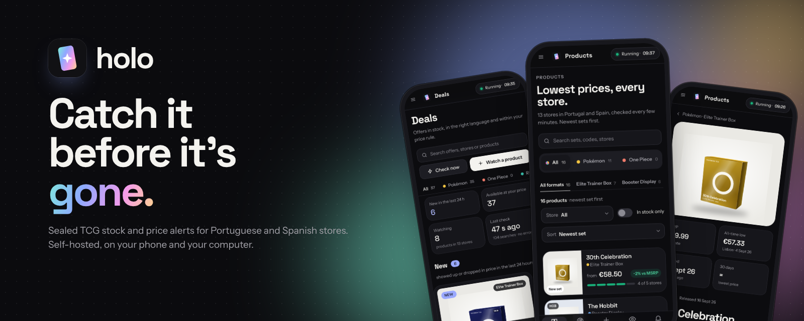
</p>

<p align="center">
  A <b>self-hosted</b> bot that watches Portuguese and Spanish stores for sealed TCG product (Pokémon, One Piece, Riftbound, Cyberpunk, Magic, Lorcana)<br>
  and tells you on <b>WhatsApp</b>, <b>Telegram</b>, <b>email</b> or <b>push</b> when it shows up <b>in stock, in the right language and at your price</b>.
</p>

<p align="center">
  
  
  
  
  
</p>

<p align="center">
  <a href="#features">Features</a> ·
  <a href="#screenshots">Screenshots</a> ·
  <a href="#quick-start-docker-on-the-nas">Quick start</a> ·
  <a href="#accounts-sign-in-and-the-phone-app">Accounts</a> ·
  <a href="#stores">Stores</a> ·
  <a href="#products-the-catalogue">Products</a> ·
  <a href="#releases">Releases</a> ·
  <a href="#development">Development</a>
</p>

<p align="center">
  
</p>

> Holo used to be called TcgStockBot. The code (projects, namespaces, containers and the `tcgstockbot-data` volume)
> keeps the old name, so updates never lose anything.

---

## Features

**Game tabs**

- Every main page (Products, Deals, Watching, Releases and Alerts) has **All · Pokémon · One Piece · Riftbound ·
  Cyberpunk · Magic** tabs, plus Lorcana or Other when you use them. The choice is kept in the browser.

**Watching products**

- Each **watched product** (task) can be one product (30th ETB) or a **whole set** (Chaos Rising): the search text, the words it must have and must not have (with `a|b` alternatives and `op*` prefixes), the **product types** you want (ETB, Booster Bundle, Display…; none = all), the **language** (English or Japanese), the stores and the **game** (Pokémon, One Piece, Riftbound, Cyberpunk, Lorcana, Magic or other).
- **Price rule:** **MSRP + a margin** (each type compared with its own MSRP: a booster with a booster's MSRP, a display with a display's) or a **fixed maximum price**.
- **The right game:** a generic product (booster box, booster, deck…) only counts if the title names the game ("Pokémon",
  "PKM", "One Piece"…) or one of its known sets, so a Flesh & Blood or Naruto display never shows up as Pokémon.
  Formats only Pokémon has (ETB, Booster Bundle, UPC…) don't need it.
- One Piece **starter decks** are recognised by their code (ST-01, ST01, ST 1), whatever the rest of the title says.
- **Magic: The Gathering:** Play Booster Box/Display, **Collector Booster** (box and single), **Bundle** and Gift Bundle,
  **Commander Deck** (each deck is its own product, even with "Collector Booster Sample Pack" in the title) and Prerelease Pack.
  Sets from Bloomburrow on (including Final Fantasy, Spider-Man, Avatar, Lorwyn Eclipsed, TMNT, Secrets of
  Strixhaven, Marvel Super Heroes, The Hobbit, Reality Fracture and Star Trek) are already known. Magic has no reference
  MSRP: use a **maximum price** on its tasks.
- Every cycle, the bot searches every store and explains each result: *at your price*, *above · alerts up to €65.99*, *sold out*, *not English*, *a type you don't watch*, *missing the word…*.
- Results and alerts carry the **product image** the store returns.
- Import and export watched products (tasks) as JSON from the **More** menu in *Watching*.

**Products (the catalogue) and prices**

- **Products** (the home page): pick the **game**, then the **format** (Elite Trainer Box, Booster Display,
  Collector, Bundles, Boosters, Blisters, Collections, Tins, Decks, Prerelease) and you get that product from **every set**, newest
  first. Each card has the set, the photo, "from €X", "−8% vs MSRP", the 30-day change and "in stock at 3 of 5 stores".
  Filters by store and "in stock only"; sort by newest set, cheapest, most stores in stock, biggest drop or name.
- **One product = game + set + format**, whichever watched product found it. The bot recognises the set from the
  store's title: the name ("Pitch Black"), the code ("ME05", "OP-13", "op13") or other names. So "Pitch Black ETB",
  "PKM ME05 Pitch Black Elite Trainer Box" and "Mega Evolution 5 - Pitch Black ETB" are the same product, even with a
  single watched product for every ETB.
- **Product page:** at the top, the cheapest in stock and the button to open the store; right below, **the price in
  every store, cheapest first** (with PT/ES, "−8% vs MSRP" and when it was checked), with sold-out stores folded away.
  Then the price facts (all-time low, 30-day change, MSRP), the **other formats of the same set**, the **price chart**
  by period, the history of changes and the corrections (split or merge listings).
- **Shipping included:** each store can have a shipping cost and the amount from which shipping is free (in *Stores →
  Edit → Shipping*). The store order, "cheapest" and the alerts count shipping: an ETB at €52 + €6 shipping ranks
  behind one at €55 with free shipping. Each row shows "+ €4.99 shipping" or "Free shipping"; stores without shipping
  set count as €0.
- **Lowest price ever:** when today's best price is the lowest the bot has seen at any store (for a product followed
  for at least a week), the card and the product page show **Lowest price ever**.
- **Restocks:** the product page says how many times it came back in stock at each store and when the last one was,
  and next to sold-out stores it shows when that store usually restocks.
- **MSRP** per product type (ETB, Booster Bundle, Display…), so you see how far above or below the reference price each offer is.

**Releases**

- A calendar of upcoming sets, as a **list** (pre-orders open, coming up, already out) or **month by month**, with the
  release date and when pre-orders open. Each release can be linked to the product you watch, to see its offers right
  there; if you don't watch it yet, **Watch** opens the search already filled in.
- **Sets:** the bot already knows the English sets of Pokémon (Scarlet & Violet and Mega Evolution), One Piece
  (OP-01 to OP-18, EB and PRB), Riftbound, Cyberpunk and Magic (`Features/Sets/Data/set-defaults.json`), and every one
  with a date **shows up in Releases by itself** (tagged *Built-in*). Editing one saves the pre-order date, notes and
  link. A new set comes in when you add it in Releases: its name (without the game in front) and its **other names in
  stores** (for example `ME06`) start grouping that set's products in Products.
- Each release shows what the stores have of that set ("4 products · 3 in stock · from €54.99") and opens Products
  with only that set.

**Alerts**

- **Push notifications** on the phone and the computer, with no third-party service and nothing in `.env`: in *Settings →
  Alert channels → Push notifications*, tap **Turn on for this device**. Tapping the notification opens the store page.
- **WhatsApp** (CallMeBot), **Telegram** (your own bot) and **email** (SMTP), with a direct link to the product page.
- Alerts mention the store's shipping ("+ €4.99 shipping" or "free shipping") when it's set.
- An optional **daily summary** at the hour you pick: the alerts of the last 24 hours, what's in stock at your price and the stores with errors.
- A product is only announced once while it stays in stock, unless **its price drops**.
- **Pre-orders** are marked in the alert and on the dashboard.
- Stores that don't put the language in the title can **alert anyway, with "check the language"**.

**Dashboard**

- **Deals** (formerly Radar): the offers you can buy right now. **What's new** in the last 24 hours as big cards (photo, store, price and "−8% vs MSRP"); the ones still available in a list you filter by type and sort by date, price or MSRP. Beside them, the **latest moves** (restocks, drops and pre-orders, with the game), store health and activity.
- **Watching:** a card per product or set with its price rule and, **per type** (ETB, Bundle, Display, Booster), the best price right now. Each one has its own page: the limits per type, what the stores have (by type or by store) and why it alerted or not, the price history and the alerts.
- **Watch a product:** search every store at once, tick the right results and the rules (name, types, MSRP + margin, words, stores) are suggested from them.
- **Stores:** Portuguese and Spanish stores grouped by **area** (Portugal, Spain, Europe) and **tier**, with how each search went on the last cycle, tags and notes. **Detect** the platform from a link, **test** several stores at once, and turn off the ones that keep failing. **Test a store** opens from here.
- **Menu in two groups:** **Shop** (Products, Deals, Releases), to buy, and **Bot** (Watching, Alerts, Stores, Settings), to set it up.
- **Holo design:** navigation bar at the top (a tab bar at the bottom on the phone), titles and prices in Space Grotesk
  and text in Instrument Sans (served by the app itself), green for "in stock" and "below MSRP", and a "box" in the
  set's colours when the store has no photo.
- **Themes:** Holo, Coral, Lavender and Ocean, in dark (the default), light or automatic mode.
- **Accounts:** everyone signs in with their own user (Sign in / Create account), with "Keep me signed in"; the admin manages the accounts. A **landing page** for visitors who aren't signed in.
- **In English**, with prices in euros (€54.99) and European dates.
- **Phone app:** tab bar at the bottom, and it installs on the home screen with the Holo icon.
- Shortcuts: `1`–`7` switch pages, `N` watches a new product, `/` jumps to search and `R` checks now.

**Built to run at home**

- Two containers in one `docker-compose.yml`, made for a UGREEN NAS: the **bot** and the **dashboard** with sign-in.
- Each store is read only through what it allows: the store's public search, an official API or an affiliate feed. It never gets around CAPTCHAs or anti-bot protection.
- Request limits per domain, honours stores' `Retry-After` and never writes secrets to the logs.

> It only watches and alerts: you do the buying.

## Screenshots

With example data: invented stores, example prices and drawings instead of photos (when a store returns the product photo, it replaces the drawing).

### Shopping
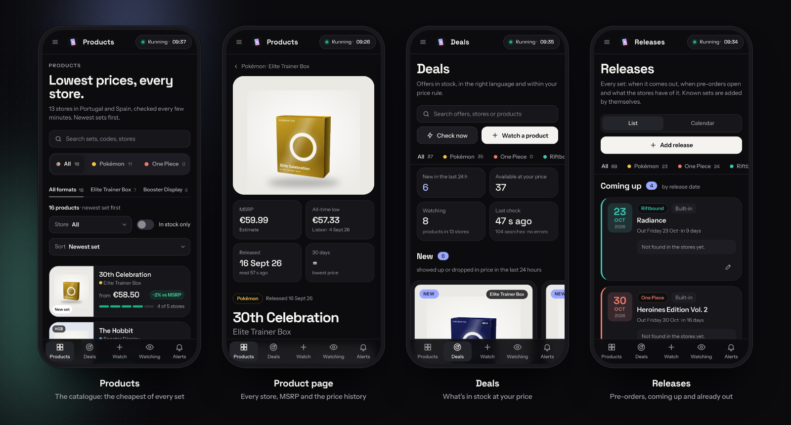

### The bot
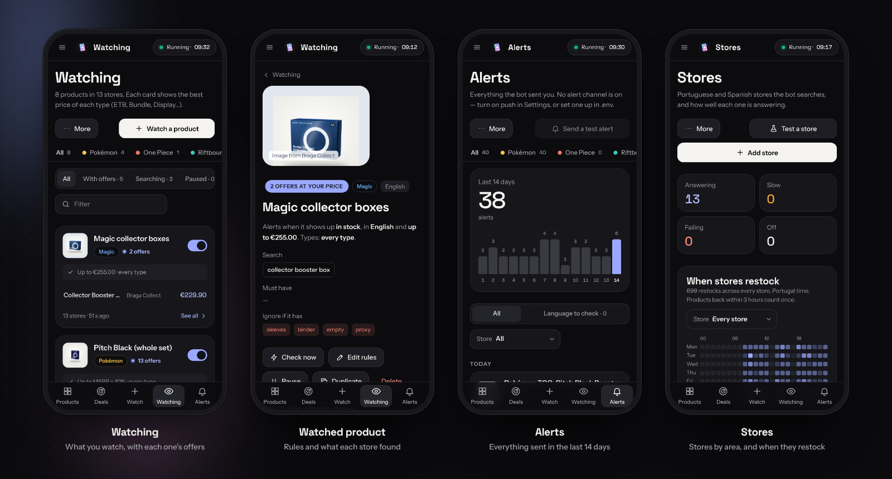

### On the computer
<table>
<tr>
<td width="50%"><b>Product page</b><br>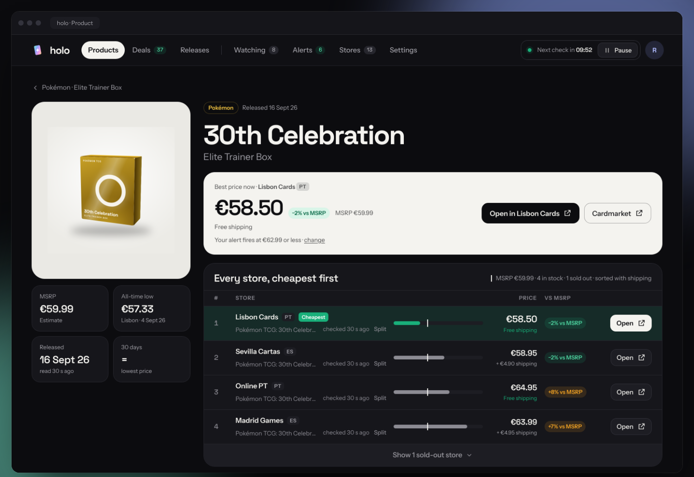</td>
<td width="50%"><b>Deals</b><br>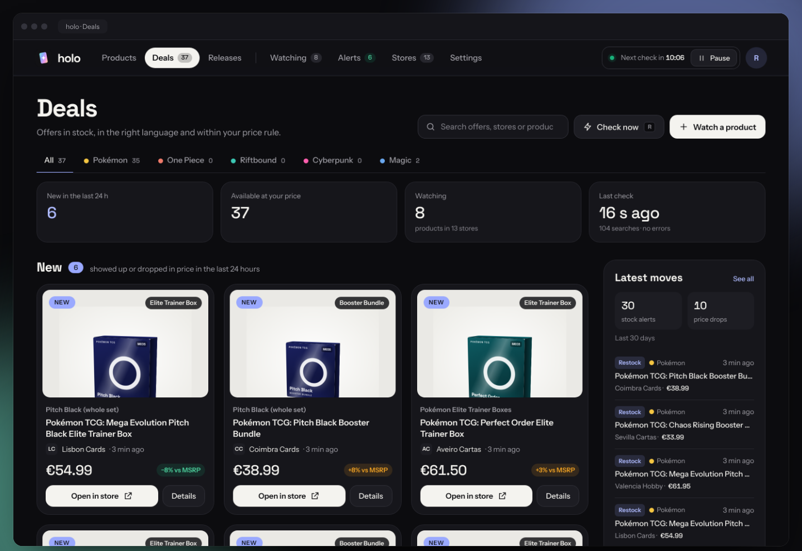</td>
</tr>
<tr>
<td width="50%"><b>Watching</b><br>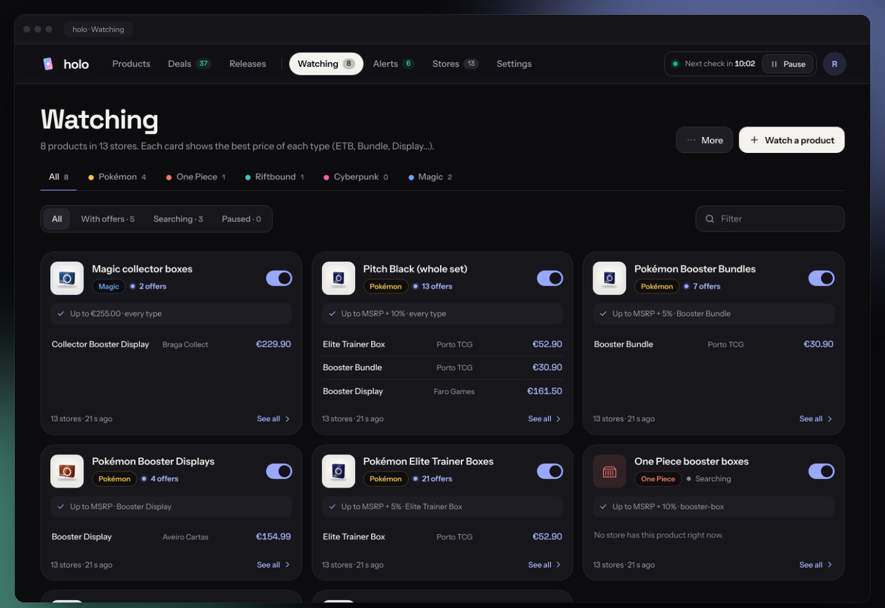</td>
<td width="50%"><b>Watched product</b><br>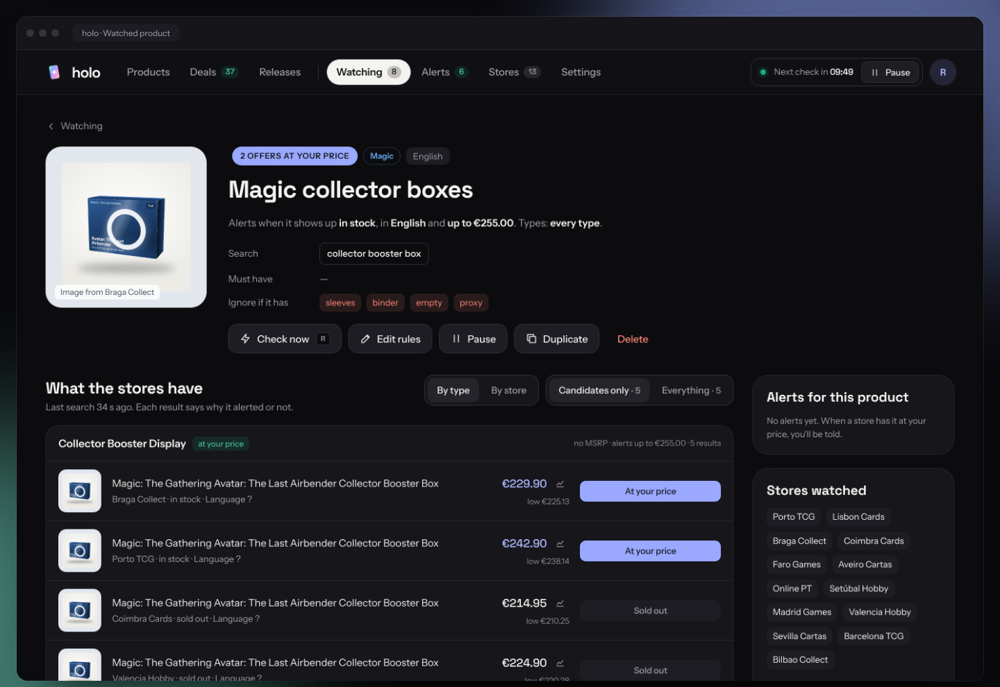</td>
</tr>
<tr>
<td width="50%"><b>Alerts</b><br>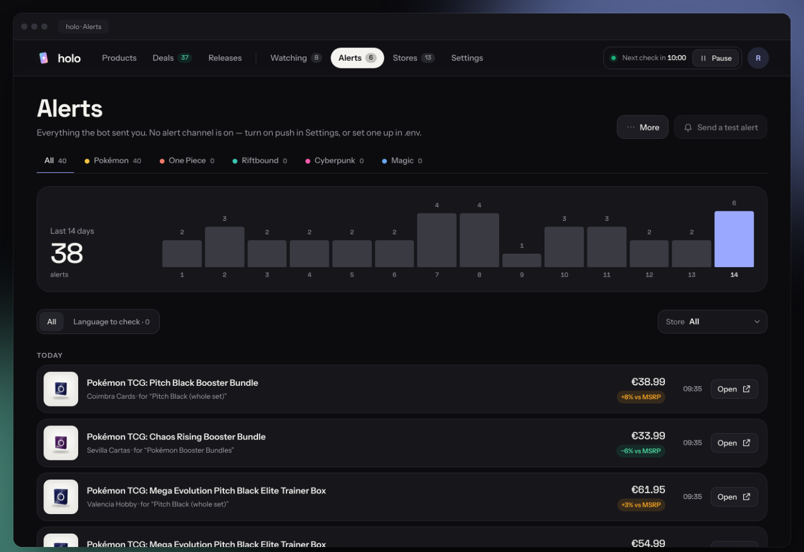</td>
<td width="50%"><b>Stores</b><br>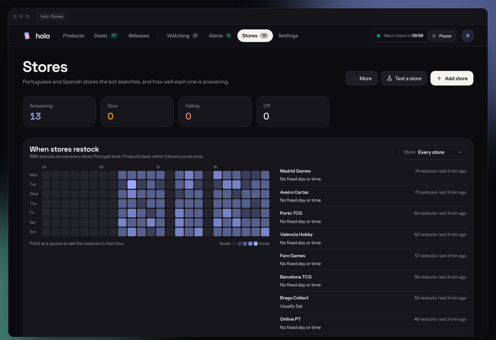</td>
</tr>
<tr>
<td width="50%"><b>Releases</b><br>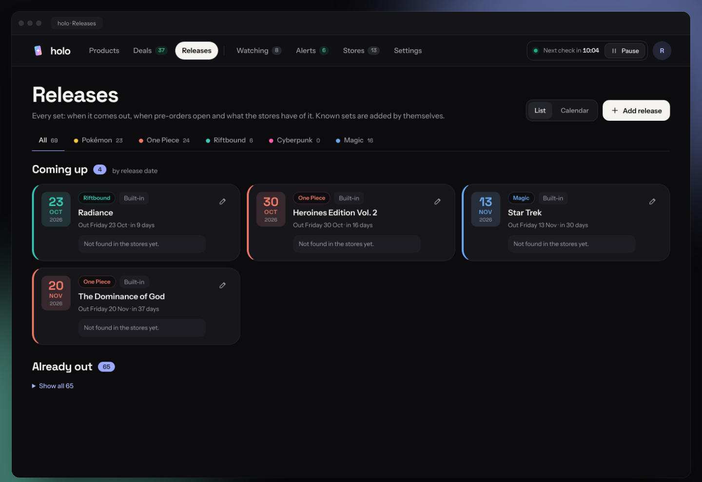</td>
<td width="50%"><b>Settings</b><br>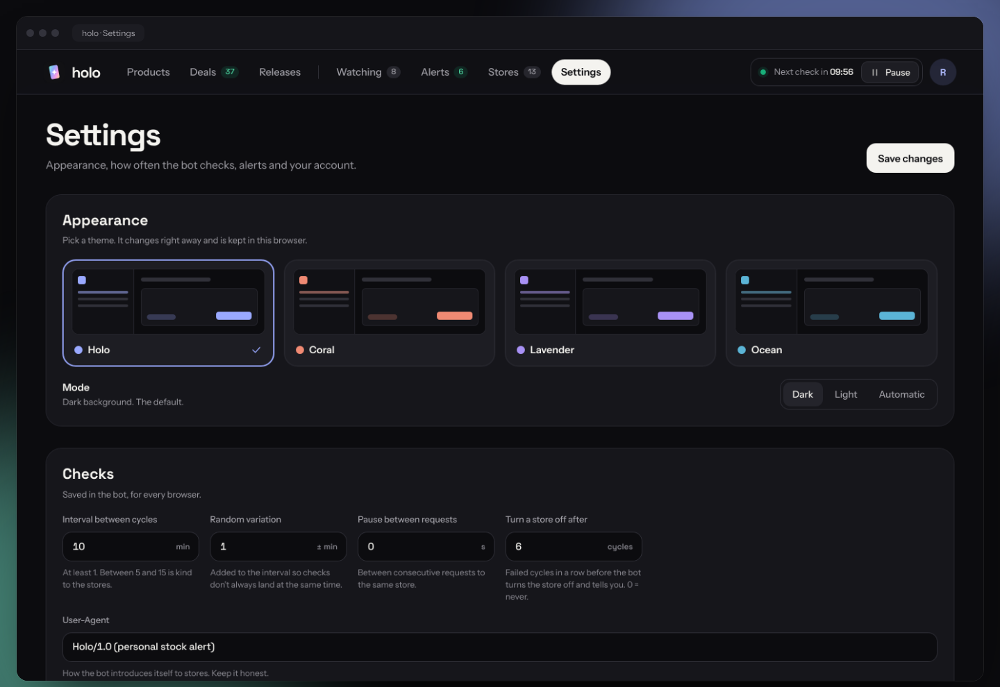</td>
</tr>
</table>

### Dark and light
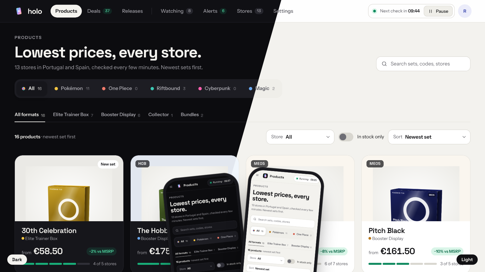

### Themes

Four colours (Holo, Coral, Lavender and Ocean), each in dark (the default), light or automatic mode, following the system.

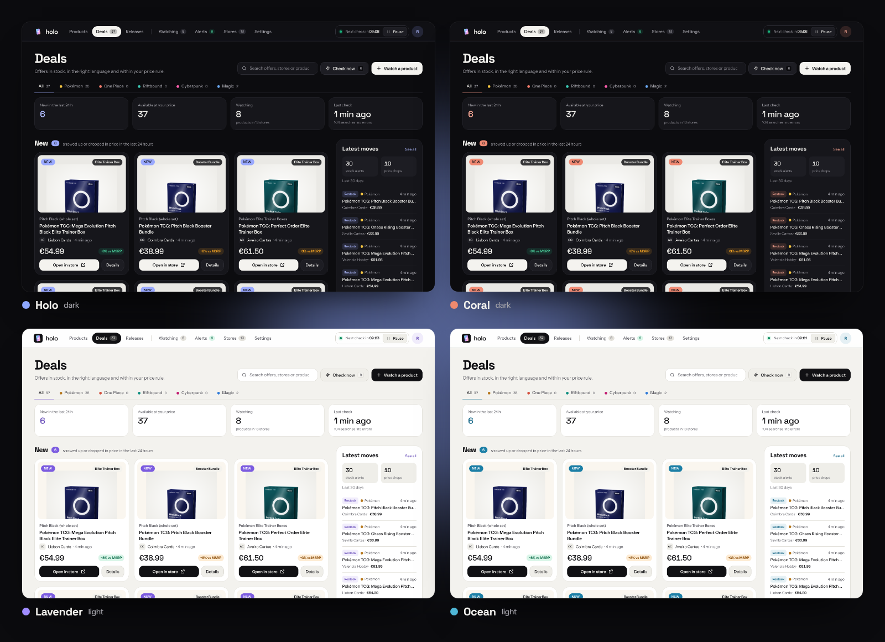

### Welcome
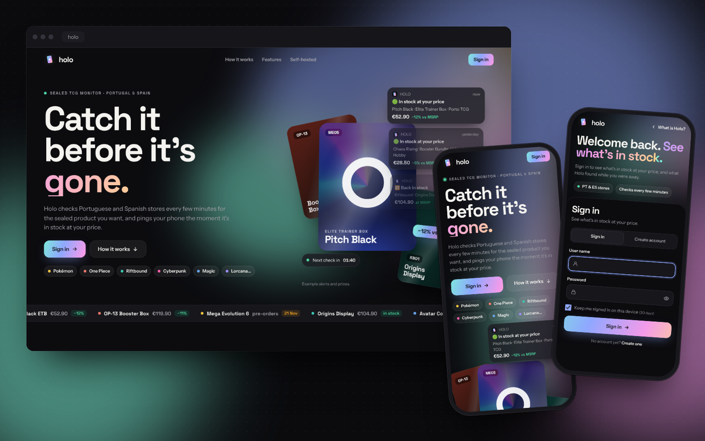

<details>
<summary>More screenshots and mocks</summary>

- Public pages at full size: [landing page](docs/screenshots/dashboard-about.png) ·
  [on the phone](docs/screenshots/dashboard-about-phone.png) · [Sign in](docs/screenshots/dashboard-sign-in.png) ·
  [Sign in on the phone](docs/screenshots/dashboard-sign-in-phone.png) ·
  [first account, with the setup key](docs/screenshots/dashboard-create-account.png)
- The approved HTML mocks are in [`docs/mocks`](docs/mocks): the landing page with Sign in (`holo-welcome.html`)
  and the app's screens. Open them in a browser.
</details>

## Quick start (Docker on the NAS)

```bash
cp .env.example .env          # fill in DASHBOARD_PASSWORD (setup key), TCG_API_KEY and WhatsApp, Telegram and/or email
docker compose up -d --build --remove-orphans
# open http://<nas-ip>:5080
```

Two containers:

| Container | Port | What it does |
| --- | --- | --- |
| `tcgstockbot-webapi` | none | the bot: background monitor and JSON API (`x-api-key`) |
| `tcgstockbot-website` | `5080` | Holo (the dashboard), with sign-in |

1. Copy the solution folder to the NAS (for example `docker/tcgstockbot`).
2. Copy `.env.example` to `.env` and fill in `DASHBOARD_PASSWORD`, `TCG_API_KEY` (a long random key) and WhatsApp, Telegram and/or email.
3. Start it from the UGOS Docker app (a *Project* pointing at the folder) or over SSH, with the command above.
4. Open `http://<nas-ip>:5080`.

**Updating:** `git pull` in the folder and the same `docker compose up -d --build --remove-orphans`. `.env` isn't in git, so it's never touched. If you come from a version with the proxy (`price-proxy`), `--remove-orphans` removes that container, and any `OutboundHttp__Proxy__…` lines left in `.env` are ignored.

Settings, tasks, history and releases live in the `tcgstockbot-data` volume; the session keys (so "keep me signed in"
survives updates) live in the `tcgstockbot-keys` volume. Never run `docker compose down -v`, which deletes them.

> [!WARNING]
> Don't open port 5080 on the router: the password would travel without HTTPS. To reach it from outside, use a VPN (for example Tailscale) or a reverse proxy with HTTPS.

**Reverse proxy (Nginx Proxy Manager).** `tcgstockbot-website` also joins the external `nas-net` network, the same
as Nginx Proxy Manager. The network must exist before `docker compose up`; if it doesn't, create it with
`docker network create nas-net`. In the proxy host, use scheme `http`, hostname `tcgstockbot-website` and port `8080`.
If the site is public, set `ALLOW_REGISTRATION=false` in `.env`.

## Accounts, sign-in and the phone app

The app is in **English**. The addresses are `#/products` (the home page), `#/radar` (Deals), `#/watching`, `#/releases`, `#/alerts`,
`#/stores` and `#/settings`; the old Portuguese links still work.

- **Accounts:** everyone signs in with their own user name and password. Accounts live in the bot (`data/users.json`),
  with the password stored only as a hash (PBKDF2). Everyone sees and changes the same products, stores and alerts.
- **First visit:** with no accounts, `http://<nas-ip>:5080` opens **Set up Holo** to create the first account,
  which becomes the **admin**. It asks for the **setup key**: the `DASHBOARD_PASSWORD` from `.env`, so nobody else on the network can create it before you.
- **Sign in / Create account:** anyone without an account creates one on the **Create account** tab (like in Living Dex).
  With `ALLOW_REGISTRATION=false` in `.env`, only the admin creates accounts, in **Settings → Account**.
- **Keep me signed in on this device** keeps the session for 30 days (`Dashboard__RememberDays`). Changing the password
  ends the sessions on other devices. Five wrong passwords in a row from the same address block attempts for 5 minutes.
- **Settings → Account:** change the password, **Sign out** and, for the admin, the list of accounts (add and delete).
- Signed out, `/` shows the **landing page** (what Holo does), also at `/about`.
- **Install on the phone:** on iPhone, in Safari, Share → *Add to Home Screen*; on Android, in Chrome,
  ⋮ → *Add to Home screen*. It gets the Holo icon and name and opens full screen. Over HTTPS (for example the NAS's
  reverse proxy or Tailscale), Chrome also offers *Install app*.

<details>
<summary><b>Coming from v2 (a single <code>tcgstockbot</code> container)?</b></summary>

Use the same folder name. The `tcgstockbot-data` volume is the same and the file format hasn't changed, so tasks, stores and history are kept.

- `--remove-orphans` removes the old container.
- In `.env`, the old `Dashboard__Password` is now called `DASHBOARD_PASSWORD`.
- Add `TCG_API_KEY` too.
</details>

> [!IMPORTANT]
> **Never commit secrets.** `.env` and the `appsettings.Development.json` files are in `.gitignore`. To run on the PC, copy `TcgStockBot.WebApi/appsettings.Development.json.example` to `appsettings.Development.json` (and the same in the Website, if you need it).

### Push notifications (phone and computer)

Holo sends alerts as system notifications, through the browser's own push service (Google, Mozilla, Apple or
Microsoft). Messages are end-to-end encrypted (RFC 8291) and signed with a key from your bot (VAPID); there's no
account and no third-party service.

1. Open Holo over **HTTPS** (your domain in Nginx Proxy Manager). Over `http://IP:5080` the browser won't allow it.
2. **iPhone and iPad (iOS 16.4 or later):** in Safari, *Share → Add to Home Screen*, and open Holo from the icon.
   Only then does iOS let a web app receive notifications.
3. In **Settings → Alert channels → Push notifications**, tap **Turn on for this device** and allow it.
4. Tap *Send a test message*. Repeat on every phone or computer you want; the list shows the devices, each one's
   account and its last notification. *Remove* takes a device off.

The keys are created on first start and live in the data volume (`push-keys.json`, the devices in
`push-subscriptions.json`). In `.env`, set `WebPush__Subject=mailto:your-email` (Apple asks for a valid contact);
`WebPush__Enabled=false` turns the channel off. The bot only accepts addresses from browsers' push services, and
devices the service reports as gone are removed automatically.

### WhatsApp (CallMeBot)

1. Save the number published at https://www.callmebot.com/blog/free-api-whatsapp-messages/ to your contacts.
2. Send it on WhatsApp: `I allow callmebot to send me messages`. The API key comes back in a reply.
3. In `.env`: `WhatsApp__Enabled=true`, `WhatsApp__Phone=+351…` (your number) and `WhatsApp__ApiKey=…`.
4. `docker compose up -d`, then in **Settings → Alert channels → WhatsApp**, tap *Send a test message*.

CallMeBot is a free third-party service, for personal use only, with no guarantees. Keep email or Telegram on as a second channel.

### Telegram

1. In Telegram, talk to **@BotFather** → `/newbot` and pick a name. You get the bot's **token**.
2. Open the new bot and send it `/start` (without this, Telegram won't let the bot write to you).
3. Find your **chat id** (for example with **@userinfobot**). In a group, the id starts with `-100`.
4. In `.env`: `Telegram__Enabled=true`, `Telegram__BotToken=…` and `Telegram__ChatId=…`.
5. `docker compose up -d`, then in **Settings → Alert channels → Telegram**, tap *Send a test message*.

The token only exists in `.env`: the dashboard only shows whether it's set, and the logs never write it.

### Daily summary

In **Settings → Daily summary**, turn the summary on and pick the hour (Portugal time). Once a day it goes out on the
channels that are on (push, email, Telegram and WhatsApp) with the alerts of the last 24 hours, what's in stock at your
price and the stores that failed on the last cycle.

## Stores

| Platform | How it searches | Product image |
| --- | --- | --- |
| `Shopify` | the store's public search (`/search/suggest.json`) or the catalogue (`/products.json`) | `featured_image` or `image`; in the catalogue, the first of `images` |
| `WooCommerce` | public Store API (`/wp-json/wc/store/…`) | the first of `images` |
| `Html` | reads the search page with CSS selectors | the card's first `` (also `data-src` for lazy-loaded images) |
| `Amazon` | official **Creators API** | `images.primary.large` |
| `ElCorteIngles`, `Worten`, `Fnac`, `Awin` (generic) | **Awin** affiliate product feed | `merchant_image_url`, `large_image`, `aw_image_url` or `aw_thumb_url` |
| `Manual` (no integration) | never searched: it only sits in the list, with link, tier and tags | — |

### Language without a marker (per store)

| Option | Behaviour |
| --- | --- |
| Don't alert | title without "(EN)/English/(PT)…" → no alert |
| Count as English | the store always marks PT/ES/JP, so no marker = English |
| **Alert, language to check** | alerts anyway, and WhatsApp, email and the dashboard ask you to check the page (used for CentroXogo) |

### Shopify stores: search or catalogue

By default the bot uses the store's search (`/search/suggest.json`), which returns **at most 10 products** per
search. In a store with many products from the same set, some are left out.

In **Stores → Edit → Catalogue** you can give one or more collections, separated by commas:

| Store | Catalogue |
| --- | --- |
| Versus Gamecenter | `/collections/pokemon-tcg-1, /collections/riftbound-league-of-legends-tcg` |
| Note! | `/collections/pokemon` |
| Trap Card TCG | `/collections/pokemon-booster-boxes, /collections/pokemon-elite-trainer-boxes, /collections/pokemon-collection-boxes, /collections/pokemon-tins, /collections/pokemon-booster-packs` |

- With a catalogue, the bot reads the collections (pages of 250 products) **once per cycle** and filters them locally
  for every task on that store. There's no limit of 10, and it's fewer requests than one search per task.
- The task's search text must appear in the product's title, type, vendor or tags (whole words, ignoring accents).
- `/products.json` reads the whole store. It works, but in a big store that's many pages per cycle, so prefer
  collections.
- To find a store's collections, open `https://<store>/collections.json` in the browser.
- An empty or wrong collection doesn't fail, it just returns no products. Check it in **Test a store**.

### Stores: areas, tiers and tags

The **Stores** page groups stores by **area** (Portugal, Spain, Europe/online) and, within each area, by **tier**:

| Tier | What for |
| --- | --- |
| **S** | MSRP / big retail (Amazon, Worten, FNAC, Continente, El Corte Inglés, Toys R Us…) |
| **A** | TCG specialists |
| **B** | Importers and smaller online stores |
| **C** | Marketplaces (Cardmarket, eBay, Wallapop, Vinted): reference only, not comparable with MSRP |

Each store also has a **type** (Retail, TCG specialist, Importer, Marketplace, Official), free **tags**
(e.g. `untested`, `check shipping to PT`) and **notes**. All of this is only classification: it doesn't change how the
store is searched. Filter by area, tier, type or tag at the top of the page (clicking a tag on a card filters too).

Extra platforms:
- **No integration** (`Manual`): the store stays in the list (link, tier, tags) but the bot **never searches it**. For
  stores you don't know how to read yet, or that don't allow automated reading.
- **Awin (generic)** (`Awin`): any other store with an Awin affiliate programme and a product feed (MediaMarkt,
  FNAC ES…). Give it a **key** (e.g. `MediaMarktES`) and put the feed URL in `AwinFeeds__Feeds__MediaMarktES` in
  `.env`. It works like the feeds in the next section.

**Import / Export JSON** (the **More** menu on the Stores page; same format both ways). For a store that already exists
(same name **or** same site), the import leaves its setup alone: with *Update classification* on, it only changes area,
tier, type and tags.

#### Detecting, testing and turning stores on

- **Detect** (in the store form, next to the URL): paste the site or its Pokémon category page. The bot makes a few
  normal requests (same User-Agent and per-domain limits) and fills in the setup:
  - **Shopify**: `/products.json` answers. It suggests the collection for catalogue mode (the one in the URL you
    pasted, or `pokemon`, `pokemon-tcg`, `pokemon-tcg-1`, `all-pokemon`);
  - **WooCommerce**: the Store API `/wp-json/wc/store/v1/products` (or without `/v1`) answers;
  - **PrestaShop**: the search `index.php?controller=search` has `product-miniature` cards. It fills in generic HTML
    selectors (check sold-out detection with Test);
  - **blocks the bot** (403/429 or an anti-bot page): it stops there and doesn't get around anything. It stays "No integration".
- **Test several stores** (the **More** menu on the Stores page): searches each store (4 at a time) with a text of your
  choice ("pokemon" by default), shows each result and saves it on the card ("Last test"). Choose which: the ones
  visible with the filters, never tested, failed, turned off or all. At the end:
  - **Turn on the ones that work**;
  - **Turn off the ones that failed**;
  - **Blocked → No integration** (with the `blocks bots (403)` tag);
  - **Detect the platform again** for the ones that errored, found 0 products or have no integration. If detection finds
    a platform, the store is updated and tested again.

  A test that finds products removes the `untested` tag. There's a "Last test" filter (never tested, OK, failed,
  turned off by the bot).
- **Automatic turn-off** (Settings → "Turn a store off after N cycles", 6 by default, 0 = never): when every search of
  an active store fails N cycles in a row, the bot turns it off, tags it `failing` and tells you once (WhatsApp/email).
  Requests postponed by the bot's own per-domain limit don't count, nor do stores still being set up (Amazon without
  credentials, a missing Awin feed). A cycle with one successful search resets the counter; so does turning the store
  back on, which also removes the tag.

### Big stores: Amazon, FNAC, Worten and El Corte Inglés

Each store is read only through what it allows. The bot doesn't get around CAPTCHAs, Cloudflare/Akamai, bot detection, IP blocks or rate limits, and it doesn't scrape Amazon.

| Store | Platform on the dashboard | Mechanism | Status |
| --- | --- | --- | --- |
| Amazon.es | `Amazon` | official **Creators API** (successor to PA-API 5) | works with Associates credentials |
| El Corte Inglés (ES) | `ElCorteIngles` | product feed from the **Awin 13075** affiliate programme | works once the programme approves you and you set up the feed |
| Worten | `Worten` | product feed from the **Awin 99897** programme ("Worten PT") | the programme exists; **it couldn't be confirmed that it has a feed** |
| FNAC Portugal | `Fnac` | no confirmed allowed mechanism | **not supported**: only works if you get an authorised Awin feed from FNAC PT |

None of the three has a public product API. The marketplace APIs (Mirakl, and FNAC's XML API) are only for sellers with an approved account, so they can't be used to follow prices. The sites answer the bot with 403, and their terms of use restrict reproducing their content. So there's **no scraper** for these stores: the providers only read the Awin feed and never contact the store's site.

<details>
<summary><b>Amazon.es (Creators API)</b></summary>

1. You need an approved **Amazon Associates** (affiliate programme) account. Amazon only gives Creators API access to accounts with **10 qualifying sales in the last 30 days**.
2. In Associates Central → *Tools → Creators API*: create an application and a credential. Note the **Credential ID**, the **Credential Secret** (shown only once) and the **version** (amazon.es = `3.2`).
3. In `.env`: `Amazon__CredentialId`, `Amazon__CredentialSecret`, `Amazon__CredentialVersion=3.2` and `Amazon__PartnerTag` (your tag, e.g. `yourtag-21`). Never in the code or in `appsettings.json`.
4. `docker compose up -d`. On the dashboard, add a store with the **Amazon** platform and base URL `https://www.amazon.es`, and tap *Test*.

In a task, the search text can be keywords (uses `SearchItems`) or an ASIN, for example `B0XXXXXXXX` or `asin:B0XXXXXXXX` (uses `GetItems`, which is more exact). The price comes from the *buy box* offer, and the seller (e.g. *Amazon.es* or a reseller) shows in the result. These count as available: `IN_STOCK`, `IN_STOCK_SCARCE`, `PREORDER`, `LEADTIME` and `AVAILABLE_DATE`.

The OAuth token lasts 1 hour and is cached. The API allows ~1 request/second and 8640/day, so the default limit for `amazon.es` is 2 seconds between requests.

Without credentials, the store shows *"Amazon: integration not configured"* and Amazon isn't contacted.
</details>

<details>
<summary><b>FNAC, Worten and El Corte Inglés (Awin feeds)</b></summary>

1. Create a *publisher* account at [Awin](https://www.awin.com) and apply to the programme: El Corte Ingles ES (13075) or Worten PT (99897). Only after approval do you get the feed. FNAC PT has no confirmed programme: if you find one, the process is the same.
2. In *Toolbox → Create-a-Feed*, pick the advertiser's feed, **CSV**, **comma** delimiter (pipe and tab also work), **gzip** or no compression, and the columns `product_name`, `search_price`, `currency`, `in_stock`, `stock_status`, `merchant_deep_link`, `aw_deep_link`, `merchant_product_id`, `merchant_name` and `merchant_image_url` (or `aw_image_url`, for the image).
3. Copy the download URL to `.env`: `AwinFeeds__Feeds__ElCorteIngles=…` (or `…__Worten`, `…__Fnac`). That URL holds your feed key, so it's **secret**. In the logs it only shows as `datafeed.api.productserve.com/… (Awin feed ElCorteIngles)`.
4. On the dashboard, add the store with the matching platform and base URL (e.g. `https://www.elcorteingles.es`).

How it works:
- The feed is downloaded **at most once every `AwinFeeds:RefreshInterval`** (6 h by default, at least 1 h) and shared by every task. Searches filter it locally (every word of the search text in the title, ignoring accents).
- A failed download is only retried after `RetryAfterFailure` (30 min). Meanwhile the last good feed is used, if there is one.
- Only products with `KeepKeywords` in the title are kept in memory (by default `pokemon`, `one piece`, `lorcana` and `gathering`), up to `MaxProducts` (5000). Big retailers' feeds have hundreds of thousands of products.
- Stock follows Awin's rules: `in_stock` 1/0 (empty = no information); otherwise `stock_quantity`, and otherwise `stock_status` (in stock / out of stock / preorder…). The link is the store's (`merchant_deep_link`); if missing, `aw_deep_link` is used.
- Feed prices lag behind until Awin's last import. Always check on the store before buying.
</details>

## Alerts, price drops and history

- **In stock:** a product that passes the task (words, language, stock and maximum price) alerts once. It doesn't
  alert again while it stays in stock, unless the price drops.
- **Price drop:** a product already announced alerts again when the price drops at least 1% and €0.50 below the
  last announced price (e.g. €130 → €115). If the price goes up and comes back to the same value, it doesn't alert again.
  The message shows the old price: "🔻 €115.00 (was €130.00)".
- **Pre-order:** marked when the title says so ("Pre-order", "Pré-venda", "Reserva", "Preventa"…) or when Amazon
  (`PREORDER`) or the Awin feed (`stock_status`) says so. It shows in the alert and on the dashboard.
- **Price history** (`data/price-history.json`): for every product a task recognises (right words and language,
  whether or not it's in stock or above the price), it saves a point whenever the price or stock changes. Up to 500
  changes per product, and products not seen for 180 days are deleted. The same product in several tasks counts as one
  (store + URL). On each product's page, the chart icon next to the price opens the history and "min" shows the lowest
  price seen. To compare stores, use **Products**.
- **When stores restock:** each time a product goes from sold out to in stock, the bot saves the day and time.
  Products that come back less than 3 hours apart count as one restock (one delivery). In **Stores**, the
  *When stores restock* grid shows restocks by weekday and hour (Portugal time), for every store or just one, and each
  store has a line like "Usually Tue · 10:00–12:00 · 9 restocks". The pattern only shows from 5 restocks; before that,
  it says how many it has seen.
- v3.0's `alert-state.json` is still read; from the first cycle it also stores the price.

## Products (the catalogue)

The **Products** page shows everything the bot finds for the products you watch, one card per product, with the same
product from every store inside it: the lowest price ("from"), how many stores have it in stock, the difference from
MSRP and the **30-day move** (the lowest price now against 30 days ago). Each product's **page** has the store table,
the chart by period and by store (when a store is sold out, its line turns dashed and lighter), the history of changes
and the Cardmarket search.

- **It's automatic.** Each product a task recognises is grouped by **set** (the task that found it) and **product
  type**, detected from the title: ETB, Booster Bundle, Booster Display, Half Display, Booster, Blister, Checklane, Tin,
  Mini Tin, Premium/Ultra/Super Premium Collection, and so on. The words left in the title (a Pokémon on a blister, the
  set in a task that isn't for one set) tell variants apart.
- **Manual corrections**, on the product page:
  - **Split** takes a listing out of the product, into a product of its own or another one;
  - **Merge a listing…** brings another store's listing into the product;
  - **Back to automatic** undoes the correction.

  Corrections are saved in `data/compare-overrides.json` and apply to the following cycles.
- The old `#/comparar` and `#/produtos` links open Products.

## Releases

The **Releases** page is your set calendar. Each release has a name, the game, the release date, the date pre-orders
open (optional), a page and notes, and can be linked to a product you watch. They live in `data/releases.json`.

- **List:** *Pre-orders open* (you can already reserve), *Coming up* and *Already out*, with "in 12 days" and, if
  linked, the offers the bot found for it.
- **Calendar:** month by month, with the release and the pre-order opening on each day.
- The menu shows how many releases have pre-orders open.

## MSRP (reference prices)

The bot keeps an **MSRP per product type** (ETB, Booster Bundle, Display, Blister, Tin…) for Pokémon, the same for every
set, in `TcgStockBot.WebApi/Features/Msrps/Data/msrp-defaults.json`. A `data/msrp.json` with the same format replaces
that file, if you want to change a value without a new build. The type comes from the product title, and the price only
applies when the title or the task says "Pokémon", so a One Piece box never picks up a Pokémon price.

Where it shows:
- The **"MSRP + margin" rule** on watched products: alerts up to the type's MSRP plus the margin (10% by default; it can be negative to only alert below MSRP). Types without an MSRP use the fixed maximum, if there is one. In the **More** menu of *Watching*, "Switch all to MSRP + 10%" changes the Pokémon products that still use a fixed maximum.
- **Deals** and product pages: "−8% vs MSRP" on each offer.
- **Settings**: the MSRP table in use.
- **Products**: "−8% vs MSRP" for the cheapest in stock, and a dashed line on the product page's chart.
- **Alerts**: "… · MSRP €59.99 (−8%)" on WhatsApp/email and "vs MSRP" in the alert list.

**There's no official euro MSRP for Portugal/Spain.** The values are estimates of the usual European launch price,
with the US MSRP (which Pokémon publishes) and the source next to each one. Check and adjust them.

## Outgoing requests: limits per domain

Set in the `OutboundHttp` section (in Docker, `OutboundHttp__…` in `.env`):

| Key | Default | Meaning |
| --- | --- | --- |
| `ConnectTimeout` | `00:00:10` | longest time to open the TCP connection to the store |
| `RateLimits:<domain>` | amazon.es 2, fnac.pt 10, worten.pt 10, elcorteingles.es 10 (Awin feeds count on Awin's host, with the default) | **minimum seconds between two requests** to the domain, including subdomains (`amazon.es` covers `www.amazon.es`); the most specific rule wins |
| `DefaultRateLimitSeconds` | `2` | the same, for domains without a rule |
| `MaxThrottleWait` | `00:00:30` | if a request would have to wait longer than this for its turn, it's postponed to the next cycle instead of hanging |
| `MaxBackoff` | `01:00:00` | ceiling for a store's `Retry-After` |

- **429/503 with `Retry-After`**: the domain is paused for the time asked (a 429 without `Retry-After` pauses
  5 minutes). There are no immediate retries: the bot tries again on the next cycle.
- Each request is logged on a line like `Outbound [Amazon] POST creatorsapi.amazon/catalog/v1/searchItems -> 200 in 312 ms`,
  with host and path but **no** query string, headers, cookies, tokens or keys.
- Product images are loaded by the browser straight from the stores; the bot only keeps the address.

### Common problems

| On the dashboard / in the log | Cause | What to do |
| --- | --- | --- |
| *The store refused the request (HTTP 403)* | the store's anti-bot protection | the bot doesn't get around it |
| *The store asked to slow down (HTTP 429)* / *Request postponed* | the store's limit or `RateLimits` | wait; raise `PollInterval` or the domain's `RateLimits` |
| *Amazon: the credentials were refused* | wrong ID/secret/version | check in Associates Central; amazon.es = `3.2` |
| *Amazon: the API answered with an error — … InvalidPartnerTag / AccessDenied* | wrong tag, or an account without Creators API access | check the tag and eligibility (10 sales in 30 days) |
| *FNAC/Worten/El Corte Inglés: integration not configured* | no Awin feed set up for the store | see "FNAC, Worten and El Corte Inglés"; without an authorised feed, the store has no data |
| *Awin refused the feed download (HTTP 401/403)* | programme not approved yet, or an incomplete URL | check the status in the Awin panel and generate a new URL |
| *…: the Awin feed is missing the columns …* | columns missing in Create-a-Feed | generate the feed with the columns listed |

## Development

### Solution layout

```
TcgStockBot.slnx
├── Directory.Build.props / Directory.Packages.props   # net10.0, nullable; central package versions
├── TcgStockBot.Library/        # shared: Enums (TcgGame, TaskLanguage…), ServiceApiResponse, validation, text (language, price)
├── TcgStockBot.WebApi/         # the bot: background monitor + JSON API (x-api-key)
│   ├── Program.cs
│   ├── TcgStockBotStartup.cs   # registrations (AddSingleton, repository before service) + pipeline
│   ├── Extensions/             # Data (BotDataContext, RepositoryBase, JsonFile), InternalControllerBase, auth, translations
│   │   └── Http/               # outgoing: per-domain limits, Retry-After, logs without secrets
│   └── Features/
│       ├── TcgStockBotOptions.cs
│       ├── StockTasks/  Stores/  Alerts/  Monitors/  Settings/  Notifications/
│       ├── Compares/  PriceHistories/  Msrps/   # catalogue (Products), price history, MSRP
│       ├── Releases/                             # Releases (data/releases.json)
│       ├── Users/                                # accounts (data/users.json, PBKDF2)
│       │   ├── Controllers/    # internal, [Route("stocktask")], {Feature}{Operation}Async, ToActionResult()
│       │   ├── Services/       # validation (private ValidateXxxAsync) + rules; return ServiceApiResponse<T>
│       │   ├── Repositories/   # data access only (JSON files in data/)
│       │   ├── Models/Entities # the stored format; never leaves the service
│       │   ├── Models/DTOs     # API contract (DTO, SaveRequest, SaveResponse, …)
│       │   └── Http/*.http     # test requests for each endpoint
│       │   (Stores/Services/Adapters: Shopify, WooCommerce, Html, Amazon/ (Creators API), Awin/ (FNAC, Worten, El Corte Inglés))
├── TcgStockBot.Sdk/            # typed WebApi client (TcgStockBotClient) + copies of the DTOs
├── TcgStockBot.Website/        # Holo (MVC)
│   ├── Controllers/            # thin: build the model, call it, return Json(AjaxDataResult); Account = sign in/out
│   ├── Model/{Feature}/        # "fat models": call the WebApi through the Sdk
│   ├── Security/               # cookie sign-in, attempt limits, session keys
│   ├── Views/Dashboard/{Index,Landing}.cshtml, Views/Account/{SignIn,CreateAccount}.cshtml, Views/Shared/_Layout.cshtml
│   └── wwwroot/                # css/{dashboard,public}.css, js/ (core, shell, one per page, editors, landing, main),
│                               # img/ (logo and app icons), manifest.webmanifest, fonts/
├── TcgStockBot.UnitTest/       # xUnit, one folder per feature (+ Sdk ↔ WebApi contract test)
└── docs/                       # README images, screenshots and the HTML mocks
```

The flow is `browser → Website (password + anti-forgery) → Sdk → WebApi (x-api-key) → data/*.json`. Everything is code from this repository: no private external libraries.

### Running on the PC (Visual Studio)

Open `TcgStockBot.slnx` and, in *Configure Startup Projects*, choose **Multiple** with `TcgStockBot.WebApi` and `TcgStockBot.Website`. In Development:
- the WebApi runs on `http://127.0.0.1:5081` (Swagger at `/swagger`, key `devkey`);
- the Website runs on `http://127.0.0.1:5080`.

Local secrets go in user-secrets:

```bash
dotnet user-secrets --project TcgStockBot.WebApi set "WhatsApp:ApiKey" "<key>"
```

### Tests

```bash
dotnet test TcgStockBot.slnx
```

`SdkContractTests` fails if a WebApi DTO gains, loses or changes a property without the Sdk copy following.

---

<sub>Pokémon, One Piece, Disney Lorcana and Magic: The Gathering are trademarks of their respective owners. This is a personal, non-commercial project, not affiliated with them or with the stores mentioned.</sub>
